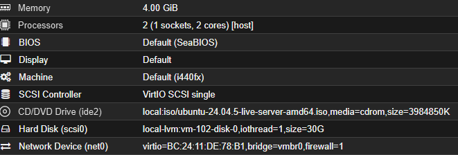
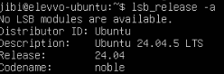
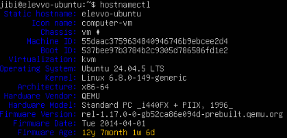
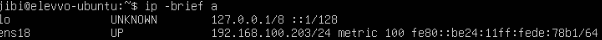
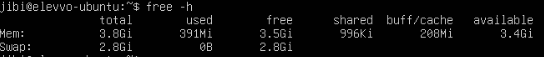
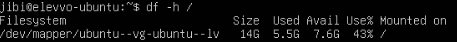
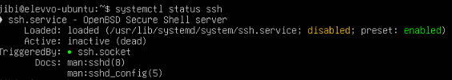

# Task 0: Environment Setup

## Goal

Set up a Linux machine to do all the internship tasks on. I used an Ubuntu Server VM on my own Proxmox home lab instead of a cloud VM.

> ✍️ **My explanation:**
> _Guide questions:_
> - Why did you pick a home lab VM over a cloud VM (cost, learning, control)?
> - What is Proxmox, in one sentence?
> - Why Ubuntu Server and not Ubuntu Desktop?

---

## Environment

| Item | Value |
|---|---|
| Host | Proxmox VE on an HP Pro Mini (192.168.100.200) |
| Guest | VM 102, Ubuntu Server 24.04.5 LTS |
| Hostname | `elevvo-ubuntu` |
| User | `jibi` (in the `sudo` group) |
| CPU / RAM | 2 cores (type `host`), 4 GB RAM |
| Disk | 30 GB (VirtIO SCSI, `iothread=1`) |
| Network | `vmbr0` bridge, LAN IP `192.168.100.203` (DHCP reservation on the router) |



> ✍️ **My explanation:**
> _Guide questions:_
> - Why set the CPU type to `host`?
> - What is a DHCP reservation, and why does the VM need a fixed IP?
> - What does the `vmbr0` bridge do for the VM?

---

## Steps

### 1. Create the VM and install Ubuntu

Created the VM in the Proxmox web UI (`:8006`) with the ISO `ubuntu-24.04.5-live-server-amd64.iso`, then ran the Ubuntu installer.

> ✍️ **My explanation:**
> _Guide questions:_
> - What options did you choose in the installer (OpenSSH server, LVM, etc.)?
> - Anything that confused you or went wrong?

### 2. Update the system

```bash
sudo apt update && sudo apt full-upgrade -y
```

> ✍️ **My explanation:**
> - What is the difference between `apt update` and `apt upgrade`?

### 3. Install the QEMU guest agent

```bash
sudo apt install -y qemu-guest-agent
sudo systemctl enable --now qemu-guest-agent
```

Then turned on **QEMU Guest Agent** in the VM's Options tab in Proxmox.

> ✍️ **My explanation:**
> - What does the guest agent let Proxmox do (show IP, clean shutdown, snapshots)?

### 4. Reserve the IP on the router

Bound MAC `bc:24:11:de:78:b1` to `192.168.100.203` on the Huawei router, so the IP never changes.

### 5. Take a snapshot

Took a Proxmox snapshot named `clean-install` so I can roll back if I break something.

> ✍️ **My explanation:**
> - Why snapshot before each task?

---

## Proof

### OS version

```bash
jibi@elevvo-ubuntu:~$ lsb_release -a
No LSB modules are available.
Distributor ID: Ubuntu
Description:    Ubuntu 24.04.5 LTS
Release:        24.04
Codename:       noble
```

<details><summary>Screenshot</summary>


</details>

### Host info

```bash
jibi@elevvo-ubuntu:~$ hostnamectl
 Static hostname: elevvo-ubuntu
       Icon name: computer-vm
         Chassis: vm
  Virtualization: kvm
Operating System: Ubuntu 24.04.5 LTS
          Kernel: Linux 6.8.0-149-generic
    Architecture: x86-64
 Hardware Vendor: QEMU
  Hardware Model: Standard PC _i440FX + PIIX, 1996_
```

<details><summary>Screenshot</summary>


</details>

### Network

```bash
jibi@elevvo-ubuntu:~$ ip -brief a
lo               UNKNOWN        127.0.0.1/8 ::1/128
ens18            UP             192.168.100.203/24 metric 100 fe80::be24:11ff:fede:78b1/64
```

<details><summary>Screenshot</summary>


</details>

### Memory

```bash
jibi@elevvo-ubuntu:~$ free -h
               total        used        free      shared  buff/cache   available
Mem:           3.8Gi       391Mi       3.5Gi       996Ki       208Mi       3.4Gi
Swap:          2.8Gi          0B       2.8Gi
```

<details><summary>Screenshot</summary>


</details>

### Disk

```bash
jibi@elevvo-ubuntu:~$ df -h /
Filesystem                         Size  Used Avail Use% Mounted on
/dev/mapper/ubuntu--vg-ubuntu--lv   14G  5.5G  7.6G  43% /
```

<details><summary>Screenshot</summary>


</details>

> ✍️ **My explanation:**
> - The disk is 30 GB but `/` is only 14 GB. Why? (Hint: Ubuntu's LVM default only uses half.)
> - How will you fix it later? (`sudo lvextend -l +100%FREE -r /dev/ubuntu-vg/ubuntu-lv`)

### SSH service at the start

Out of the box, Ubuntu 24.04 starts SSH through `ssh.socket` (it only wakes up `ssh.service` when someone connects). I changed this later in Task 1.



---

## What I learned

> ✍️ **My explanation:**
> _Guide questions:_
> - What was new to you in this task?
> - What would you do differently next time?
> - What is one command you will keep using?
