# Task 1: Secure Linux Bastion

## Goal

Turn the Ubuntu VM into a locked-down server:

1. Learn the Linux filesystem layout.
2. Log in with SSH keys only (no passwords, no root login).
3. Run a small web app as a `systemd` service that restarts itself and starts on boot.
4. Block everything with a firewall except what is needed.
5. **Bonus:** make SSH reachable only through Tailscale (a private VPN).

> ✍️ **My explanation:**
> _Guide questions:_
> - What is a "bastion" server, in your own words?
> - Why does a server facing a network need all of this?

---

## Environment

| Item | Value |
|---|---|
| VM | `elevvo-ubuntu`, Ubuntu 24.04.5 LTS (from [Task 0](../task-0-environment/README.md)) |
| Laptop | Windows 11, PowerShell |
| LAN IP | `192.168.100.203` |
| Tailscale IP | `100.89.28.19` |
| Snapshots | `before-task1`, `after-task1` |

Config files used in this task are in [configs/](configs/).

---

## Steps

### 1. Filesystem tour

```bash
jibi@elevvo-ubuntu:~$ pwd && whoami && id
/home/jibi
jibi
uid=1000(jibi) gid=1000(jibi) groups=1000(jibi),4(adm),24(cdrom),27(sudo),30(dip),46(plugdev),101(lxd)
```

```bash
jibi@elevvo-ubuntu:~$ ls -la /
total 2953308
drwxr-xr-x  23 root root       4096 Nov 13 05:54 .
drwxr-xr-x  23 root root       4096 Nov 13 05:54 ..
lrwxrwxrwx   1 root root          7 Apr 22  2024 bin -> usr/bin
drwxr-xr-x   4 root root       4096 Nov 13 06:01 boot
drwxr-xr-x  21 root root       4120 Nov 13 08:50 dev
drwxr-xr-x 109 root root       4096 Nov 13 06:02 etc
drwxr-xr-x   3 root root       4096 Nov 13 05:56 home
lrwxrwxrwx   1 root root          7 Apr 22  2024 lib -> usr/lib
drwxr-xr-x   2 root root       4096 Sep  9 06:29 opt
dr-xr-xr-x 124 root root          0 Nov 13 08:50 proc
drwx------   3 root root       4096 Sep  9 06:37 root
drwxr-xr-x  27 root root        840 Nov 13 08:50 run
lrwxrwxrwx   1 root root          8 Apr 22  2024 sbin -> usr/sbin
-rw-------   1 root root 3024093184 Nov 13 05:54 swap.img
dr-xr-xr-x  13 root root          0 Nov 13 08:50 sys
drwxrwxrwt  12 root root       4096 Nov 13 08:50 tmp
drwxr-xr-x  12 root root       4096 Sep  9 06:29 usr
drwxr-xr-x  13 root root       4096 Nov 13 06:00 var
...
```

<details><summary>Full output of <code>ls /etc</code>, <code>ls /var/log</code>, <code>ls /home</code>, <code>/etc/os-release</code></summary>

```bash
jibi@elevvo-ubuntu:~$ ls /etc | head; ls /var/log; ls /home
adduser.conf
alternatives
apparmor
apparmor.d
apport
apt
bash.bashrc
bash_completion
bash_completion.d
bindresvport.blacklist
alternatives.log  btmp                   dmesg.0     journal    README                         wtmp
apport.log        cloud-init.log         dmesg.1.gz  kern.log   syslog
apt               cloud-init-output.log  dpkg.log    landscape  sysstat
auth.log          dist-upgrade           faillog     lastlog    ubuntu-advantage-apt-hook.log
bootstrap.log     dmesg                  installer   private    unattended-upgrades
jibi

jibi@elevvo-ubuntu:~$ cat /etc/os-release
PRETTY_NAME="Ubuntu 24.04.5 LTS"
NAME="Ubuntu"
VERSION_ID="24.04"
VERSION="24.04.5 LTS (Noble Numbat)"
VERSION_CODENAME=noble
ID=ubuntu
ID_LIKE=debian
```
</details>

| Folder | What it holds |
|---|---|
| `/etc` | System config files (SSH, users, services) |
| `/var` | Data that changes, like logs in `/var/log` |
| `/home` | Each user's personal folder (here, `/home/jibi`) |
| `/opt` | Extra software we install ourselves (the web app goes here) |

> ✍️ **My explanation:**
> _Guide questions:_
> - What does `id` tell you, and why does being in group `sudo` matter?
> - Why is `/root` `drwx------` but `/tmp` `drwxrwxrwt`? What is the `t`?
> - What does `bin -> usr/bin` mean?

---

### 2. SSH key login

**On the laptop (PowerShell),** make a new Ed25519 key with a passphrase:

```powershell
ssh-keygen -t ed25519 -C "jibi-laptop-elevvo" -f $HOME\.ssh\id_ed25519_elevvo
```

```text
The key fingerprint is:
SHA256:ZWstAbDgwydgDaRZo+IvM+N6VNsC7bmnOfAPO8+bMts jibi-laptop-elevvo
The key's randomart image is:
+--[ED25519 256]--+
| .Bo. ...        |
| * =.. . .       |
|=  .= o   +      |
|o . o+   o +     |
| . + +  S + .    |
|  + = .  . .     |
| * +.o           |
|. * B*..         |
|oo  =@E.         |
+----[SHA256]-----+
```

Copy the **public** key (`.pub`) into the VM's `~/.ssh/authorized_keys`. Check permissions:

```bash
jibi@elevvo-ubuntu:~$ ls -la ~/.ssh
total 16
drwx------ 2 jibi jibi 4096 Nov 13 06:12 .
drwxr-x--- 4 jibi jibi 4096 Nov 13 06:06 ..
-rw------- 1 jibi jibi  101 Nov 13 09:11 authorized_keys
-rw-r--r-- 1 jibi jibi  142 Nov 13 06:12 known_hosts
```

<details><summary>Screenshot</summary>

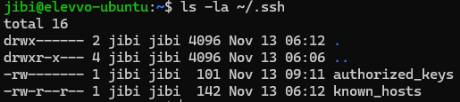
</details>

Add a shortcut in the laptop's `~/.ssh/config` so `ssh elevvo` just works (see [configs/laptop-ssh-config](configs/laptop-ssh-config)). At this point `HostName` was still the LAN IP:

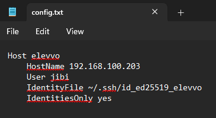

> ⚠️ Notepad saved this as `config.txt` at first. SSH needs the file to be named exactly `config` with no extension.

First key login works (asks for the key passphrase, not the account password):

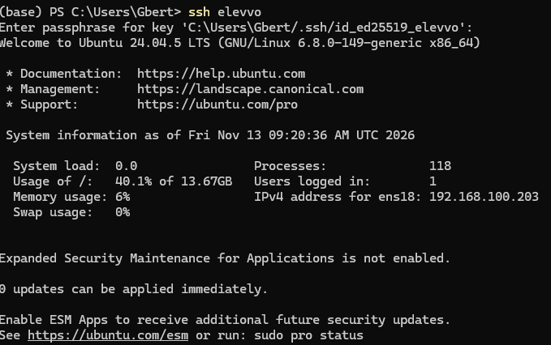

> ✍️ **My explanation:**
> _Guide questions:_
> - What is the difference between the private key and the public key? Which one leaves the laptop?
> - Why Ed25519 and not RSA?
> - Why add a passphrase to the key?
> - Why must `~/.ssh` be `700` and `authorized_keys` be `600`? (What does `chmod` do?)

---

### 3. Harden the SSH server

Added these lines to the bottom of `/etc/ssh/sshd_config` (full file: [configs/sshd_config-additions.conf](configs/sshd_config-additions.conf)):

```text
PermitRootLogin no
PasswordAuthentication no
KbdInteractiveAuthentication no
PubkeyAuthentication yes
MaxAuthTries 3
AllowUsers jibi
```

**Gotcha:** `/etc/ssh/sshd_config.d/50-cloud-init.conf` had `PasswordAuthentication yes`. Files in `sshd_config.d/` are read first, and for SSH **the first value wins**, so my `no` was being ignored. I changed that file to `no` too.

Test the config before restarting (keep a second SSH session open in case it breaks):

```bash
jibi@elevvo-ubuntu:~$ sudo sshd -t && echo "config OK"
config OK
```

<details><summary>Screenshot</summary>

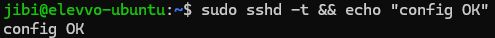
</details>

Then `sudo systemctl restart ssh`, and check what SSH is **really** using:

```bash
jibi@elevvo-ubuntu:~$ sudo sshd -T | grep -Ei 'permitrootlogin|passwordauthentication|kbdinteractive|pubkeyauthentication'
permitrootlogin no
pubkeyauthentication yes
passwordauthentication no
kbdinteractiveauthentication no
```

<details><summary>Screenshot</summary>

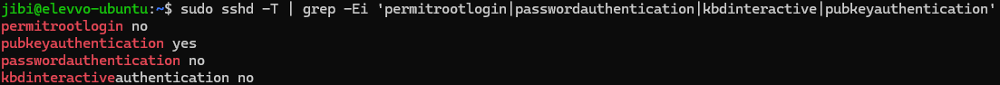
</details>

> ✍️ **My explanation:**
> _Guide questions:_
> - What does each setting block? Which attack does it stop?
> - What is the difference between `sshd -t` and `sshd -T`?
> - Why keep a second session open while editing SSH?

---

### 4. Lock root and check sudo

```bash
jibi@elevvo-ubuntu:~$ sudo passwd -S root
root L 2026-09-09 0 99999 7 -1
jibi@elevvo-ubuntu:~$ groups jibi
jibi : jibi adm cdrom sudo dip plugdev lxd
jibi@elevvo-ubuntu:~$ sudo -l
User jibi may run the following commands on elevvo-ubuntu:
    (ALL : ALL) ALL
```

The `L` means root's password is **locked**. Admin work is done by `jibi` through `sudo`.

<details><summary>Screenshot</summary>

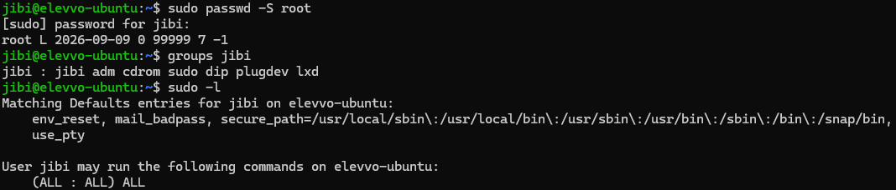
</details>

> ✍️ **My explanation:**
> - Why use `sudo` from a normal user instead of logging in as root?

---

### 5. Web app as a systemd service

Create a system user with no login shell, and the app folder:

```bash
sudo useradd --system --no-create-home --shell /usr/sbin/nologin webapp
sudo mkdir -p /opt/webapp
echo "<h1>Elevvo Task 1: served by systemd</h1>" | sudo tee /opt/webapp/index.html
sudo chown -R webapp:webapp /opt/webapp
```

These commands print nothing on success, so check the result:

```bash
jibi@elevvo-ubuntu:~$ id webapp
uid=999(webapp) gid=988(webapp) groups=988(webapp)
jibi@elevvo-ubuntu:~$ ls -la /opt/webapp
total 12
drwxr-xr-x 2 webapp webapp 4096 Nov 13 09:41 .
drwxr-xr-x 3 root   root   4096 Nov 13 09:40 ..
-rw-r--r-- 1 webapp webapp   42 Nov 13 09:41 index.html
```

<details><summary>Screenshot</summary>

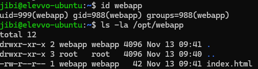
</details>

Unit file `/etc/systemd/system/webapp.service` ([configs/webapp.service](configs/webapp.service)):

```ini
[Unit]
Description=Simple Python web server (Elevvo Task 1)
After=network-online.target
Wants=network-online.target

[Service]
User=webapp
Group=webapp
WorkingDirectory=/opt/webapp
ExecStart=/usr/bin/python3 -m http.server 8080
Restart=on-failure
RestartSec=5
NoNewPrivileges=true
ProtectSystem=strict
ProtectHome=true
PrivateTmp=true

[Install]
WantedBy=multi-user.target
```

> ✍️ **My explanation:**
> _Guide questions:_
> - Why run the app as `webapp` and not as `jibi` or root?
> - What do `Restart=on-failure` and `RestartSec=5` do?
> - Pick two hardening lines (`NoNewPrivileges`, `ProtectSystem=strict`, ...) and explain them.
> - What does `WantedBy=multi-user.target` mean?

---

## Proof

### SSH: passwords and root are refused, key works

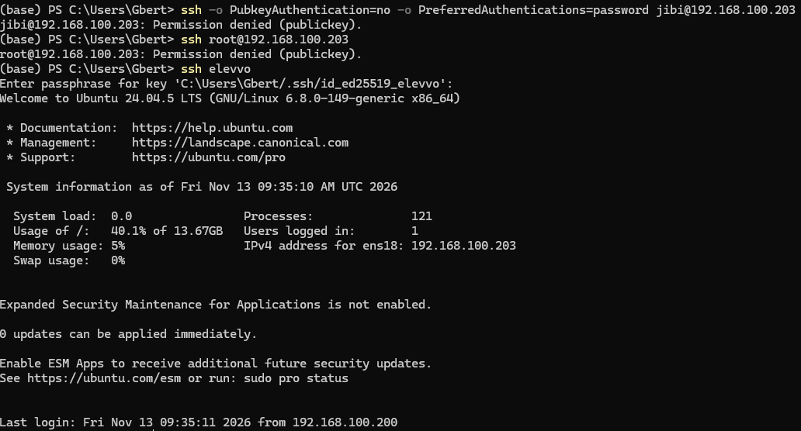

```text
PS> ssh -o PubkeyAuthentication=no -o PreferredAuthentications=password jibi@192.168.100.203
jibi@192.168.100.203: Permission denied (publickey).
PS> ssh root@192.168.100.203
root@192.168.100.203: Permission denied (publickey).
PS> ssh elevvo
Enter passphrase for key 'C:\Users\Gbert/.ssh/id_ed25519_elevvo':
Welcome to Ubuntu 24.04.5 LTS ...
```

### Service start and stop

```bash
jibi@elevvo-ubuntu:~$ sudo systemctl start webapp && systemctl status webapp --no-pager
● webapp.service - Simple Python web server (Elevvo Task 1)
     Loaded: loaded (/etc/systemd/system/webapp.service; disabled; preset: enabled)
     Active: active (running) since Fri 2026-11-13 09:43:42 UTC; 17ms ago
   Main PID: 1533 (python3)
     CGroup: /system.slice/webapp.service
             └─1533 /usr/bin/python3 -m http.server 8080
```

```bash
jibi@elevvo-ubuntu:~$ sudo systemctl stop webapp && systemctl status webapp --no-pager
○ webapp.service - Simple Python web server (Elevvo Task 1)
     Loaded: loaded (/etc/systemd/system/webapp.service; disabled; preset: enabled)
     Active: inactive (dead)
```

<details><summary>Screenshots</summary>

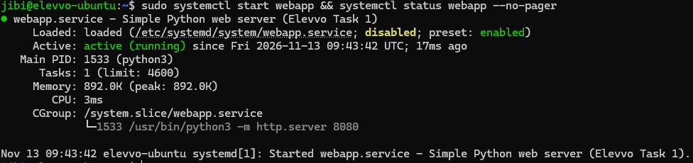
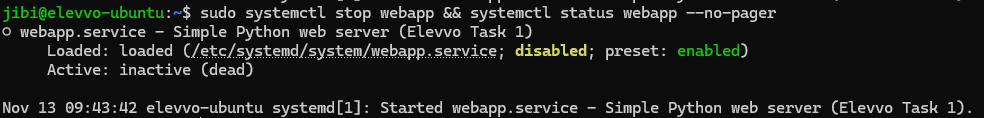
</details>

### Enabled on boot

```bash
jibi@elevvo-ubuntu:~$ sudo systemctl enable --now webapp
Created symlink /etc/systemd/system/multi-user.target.wants/webapp.service → /etc/systemd/system/webapp.service.
jibi@elevvo-ubuntu:~$ systemctl is-enabled webapp
enabled
```

<details><summary>Screenshot</summary>

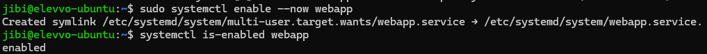
</details>

### Crash test: SIGKILL, it comes back after 5 seconds

```bash
jibi@elevvo-ubuntu:~$ sudo systemctl kill -s SIGKILL webapp; sleep 6; systemctl status webapp --no-pager
● webapp.service - Simple Python web server (Elevvo Task 1)
     Active: active (running) since Fri 2026-11-13 09:47:24 UTC; 962ms ago
   Main PID: 1605 (python3)
Nov 13 09:47:24 elevvo-ubuntu systemd[1]: webapp.service: Scheduled restart job, restart counter is at 1.
Nov 13 09:47:24 elevvo-ubuntu systemd[1]: Started webapp.service - Simple Python web server (Elevvo Task 1).
```

<details><summary>Screenshot</summary>

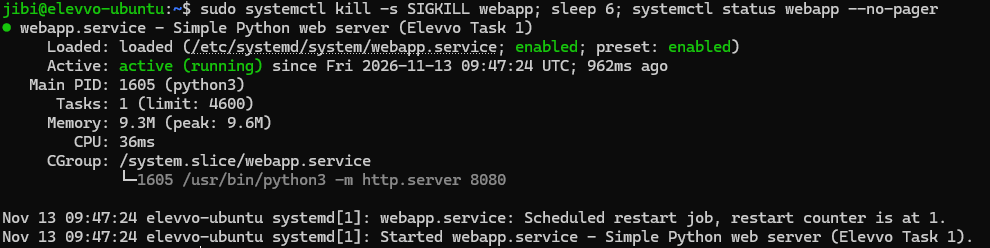
</details>

### Reboot test: it starts by itself

```bash
jibi@elevvo-ubuntu:~$ systemctl status webapp --no-pager
● webapp.service - Simple Python web server (Elevvo Task 1)
     Loaded: loaded (/etc/systemd/system/webapp.service; enabled; preset: enabled)
     Active: active (running) since Fri 2026-11-13 09:48:13 UTC; 1min 41s ago
   Main PID: 812 (python3)
```

<details><summary>Screenshot</summary>

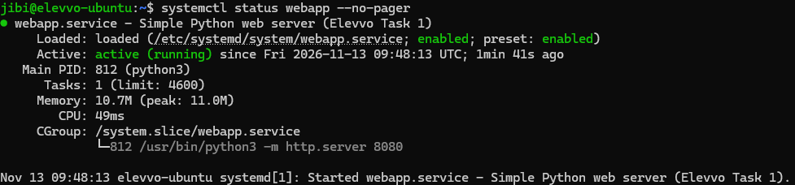
</details>

### Journal: the whole story

```bash
jibi@elevvo-ubuntu:~$ journalctl -u webapp -n 20 --no-pager
Nov 13 09:43:42 ... Started webapp.service - Simple Python web server (Elevvo Task 1).
Nov 13 09:44:51 ... Stopped webapp.service - Simple Python web server (Elevvo Task 1).
Nov 13 09:45:39 ... Started webapp.service - Simple Python web server (Elevvo Task 1).
Nov 13 09:47:19 ... webapp.service: Sent signal SIGKILL to main process 1596 (python3) on client request.
Nov 13 09:47:19 ... webapp.service: Main process exited, code=killed, status=9/KILL
Nov 13 09:47:19 ... webapp.service: Failed with result 'signal'.
Nov 13 09:47:24 ... webapp.service: Scheduled restart job, restart counter is at 1.
Nov 13 09:47:24 ... Started webapp.service - Simple Python web server (Elevvo Task 1).
Nov 13 09:48:05 ... Stopped webapp.service - Simple Python web server (Elevvo Task 1).
-- Boot af8afba068b5465582fc548dd575dc2c --
Nov 13 09:48:13 ... Started webapp.service - Simple Python web server (Elevvo Task 1).
```

<details><summary>Screenshot</summary>

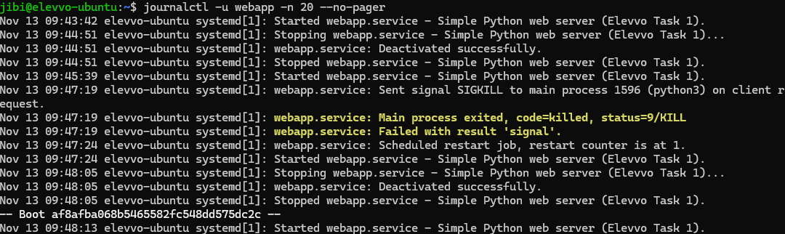
</details>

> ✍️ **My explanation:**
> _Guide questions:_
> - Walk through the journal: which line is the kill, the auto restart, the reboot?
> - Why did SIGKILL trigger a restart but `systemctl stop` did not?

### App in the browser


Same check from the laptop's command line, through the firewall (`curl.exe` because plain `curl` in PowerShell is an alias for `Invoke-WebRequest`):

```text
PS> curl.exe -I http://192.168.100.203:8080
HTTP/1.0 200 OK
Server: SimpleHTTP/0.6 Python/3.12.3
Date: Sat, 14 Nov 2026 08:26:36 GMT
Content-type: text/html
Content-Length: 42
Last-Modified: Fri, 13 Nov 2026 09:41:10 GMT
```

<details><summary>Screenshot</summary>

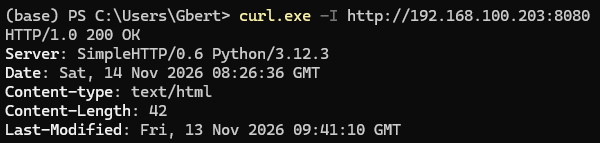
</details>

---

### 6. Firewall (UFW)

```bash
sudo ufw default deny incoming
sudo ufw default allow outgoing
sudo ufw allow OpenSSH      # allow SSH BEFORE enabling, or you lock yourself out
sudo ufw allow 8080/tcp
sudo ufw enable
```

```bash
jibi@elevvo-ubuntu:~$ sudo ufw status verbose
Status: active
Logging: on (low)
Default: deny (incoming), allow (outgoing), disabled (routed)
New profiles: skip

To                         Action      From
--                         ------      ----
22/tcp (OpenSSH)           ALLOW IN    Anywhere
8080/tcp                   ALLOW IN    Anywhere
22/tcp (OpenSSH (v6))      ALLOW IN    Anywhere (v6)
8080/tcp (v6)              ALLOW IN    Anywhere (v6)
```

This is the state before the bonus. In the bonus, SSH gets limited to Tailscale only.

> **Note:** Port 8080 is open for Task 1 only. In Task 2, the app moves to `127.0.0.1` behind Nginx.

> ✍️ **My explanation:**
> _Guide questions:_
> - What does "default deny incoming" mean in plain words?
> - Why allow SSH before `ufw enable`?

---

## Bonus: SSH only over Tailscale

Tailscale gives the VM a private `100.x.x.x` IP that only my own devices can reach. SSH now listens **only** on that IP, so it is invisible on the LAN.

### Steps

1. Install Tailscale and log in:

   ```bash
   curl -fsSL https://tailscale.com/install.sh | sh
   sudo tailscale up
   tailscale ip -4      # 100.89.28.19
   ```

2. Add `ListenAddress 100.89.28.19` to `/etc/ssh/sshd_config`.

3. Ubuntu 24.04 uses `ssh.socket`, which ignores `ListenAddress`. Switch to the normal service:

   ```bash
   sudo systemctl disable --now ssh.socket
   sudo systemctl enable ssh.service
   ```

4. Make `sshd` start after Tailscale on boot:

   ```bash
   sudo systemctl edit ssh
   ```

   ```ini
   [Unit]
   After=tailscaled.service
   Wants=tailscaled.service
   ```

   Saved in [configs/ssh-override.conf](configs/ssh-override.conf).

5. Allow binding to an IP that does not exist yet (added after a reboot broke SSH, see [What I learned](#what-i-learned)):

   ```bash
   echo "net.ipv4.ip_nonlocal_bind = 1" | sudo tee /etc/sysctl.d/99-nonlocal-bind.conf
   sudo sysctl --system
   sudo reboot
   ```

   `After=tailscaled.service` only waits for the Tailscale service to start, not for the `100.x` IP to be ready. This setting lets `sshd` bind to the Tailscale IP early, so SSH comes up on every boot. Saved in [configs/99-nonlocal-bind.conf](configs/99-nonlocal-bind.conf).

   ```bash
   jibi@elevvo-ubuntu:~$ sysctl net.ipv4.ip_nonlocal_bind
   net.ipv4.ip_nonlocal_bind = 1
   ```

   <details><summary>Screenshot</summary>

   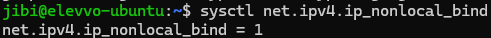
   </details>

6. Test, restart, and update the firewall:

   ```bash
   sudo sshd -t && sudo systemctl restart ssh
   sudo ufw allow in on tailscale0 to any port 22 proto tcp
   sudo ufw delete allow OpenSSH
   ```

7. On the laptop, change `HostName` in `~/.ssh/config` to `100.89.28.19`.

### Proof

`ssh.socket` is off and `ssh.service` is on (these commands print nothing on success, so check):

```bash
jibi@elevvo-ubuntu:~$ systemctl is-enabled ssh.socket ssh.service
disabled
enabled
```

<details><summary>Screenshot</summary>

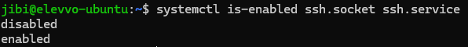
</details>

The Tailscale override is loaded on top of the stock unit:

```bash
jibi@elevvo-ubuntu:~$ systemctl cat ssh
# /usr/lib/systemd/system/ssh.service
[Unit]
Description=OpenBSD Secure Shell server
Documentation=man:sshd(8) man:sshd_config(5)
After=network.target auditd.service
ConditionPathExists=!/etc/ssh/sshd_not_to_be_run

[Service]
EnvironmentFile=-/etc/default/ssh
ExecStartPre=/usr/sbin/sshd -t
ExecStart=/usr/sbin/sshd -D $SSHD_OPTS
ExecReload=/usr/sbin/sshd -t
ExecReload=/bin/kill -HUP $MAINPID
KillMode=process
Restart=on-failure
RestartPreventExitStatus=255
Type=notify
RuntimeDirectory=sshd
RuntimeDirectoryMode=0755

[Install]
WantedBy=multi-user.target
Alias=sshd.service

# /etc/systemd/system/ssh.service.d/override.conf
[Unit]
After=tailscaled.service
Wants=tailscaled.service
```

<details><summary>Screenshot</summary>

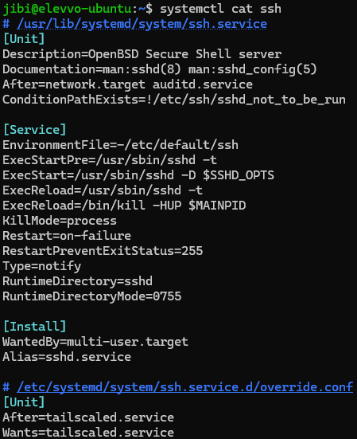
</details>

SSH listens only on the Tailscale IP:

```bash
jibi@elevvo-ubuntu:~$ sudo ss -tlnp | grep :22
LISTEN 0      128      100.89.28.19:22      0.0.0.0:*    users:(("sshd",pid=2188,fd=3))
```

Laptop `~/.ssh/config` now points at the Tailscale IP ([configs/laptop-ssh-config](configs/laptop-ssh-config)):

```text
Host elevvo
    HostName 100.89.28.19
    User jibi
    IdentityFile ~/.ssh/id_ed25519_elevvo
    IdentitiesOnly yes
```

SSH to the LAN IP `192.168.100.203` times out, and `ssh elevvo` over Tailscale logs in:

```text
PS> ssh jibi@192.168.100.203
ssh: connect to host 192.168.100.203 port 22: Connection timed out
```

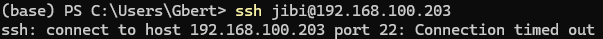

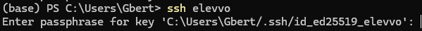

The "Last login ... from 100.89.230.112" line is the laptop's Tailscale IP, so the session came in over Tailscale.

Final firewall (22 only on `tailscale0`, plus 8080):

```bash
jibi@elevvo-ubuntu:~$ sudo ufw status verbose
Status: active
Logging: on (low)
Default: deny (incoming), allow (outgoing), disabled (routed)
New profiles: skip

To                         Action      From
--                         ------      ----
8080/tcp                   ALLOW IN    Anywhere
22/tcp on tailscale0       ALLOW IN    Anywhere
8080/tcp (v6)              ALLOW IN    Anywhere (v6)
22/tcp (v6) on tailscale0  ALLOW IN    Anywhere (v6)
```

<details><summary>Screenshot</summary>

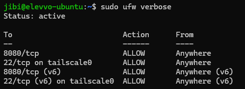
</details>

### Auth log: rejected logins

```bash
jibi@elevvo-ubuntu:~$ sudo grep -E "Failed|Invalid|not allowed|preauth" /var/log/auth.log | tail -n 15
2026-11-13T09:32:52.722913+00:00 elevvo-ubuntu sshd[1300]: Connection reset by authenticating user jibi 192.168.100.200 port 60250 [preauth]
2026-11-13T09:33:29.538815+00:00 elevvo-ubuntu sshd[1302]: Connection reset by authenticating user jibi 192.168.100.200 port 63675 [preauth]
2026-11-13T09:33:38.030876+00:00 elevvo-ubuntu sshd[1304]: Connection reset by authenticating user jibi 192.168.100.200 port 57302 [preauth]
2026-11-13T09:33:40.820311+00:00 elevvo-ubuntu sshd[1306]: Connection reset by authenticating user jibi 192.168.100.200 port 57051 [preauth]
2026-11-13T09:33:59.213288+00:00 elevvo-ubuntu sshd[1310]: User root from 192.168.100.200 not allowed because not listed in AllowUsers
2026-11-13T09:33:59.227753+00:00 elevvo-ubuntu sshd[1310]: Connection reset by invalid user root 192.168.100.200 port 55197 [preauth]
2026-11-13T09:35:27.469210+00:00 elevvo-ubuntu sshd[1382]: Connection reset by authenticating user jibi 192.168.100.200 port 53687 [preauth]
2026-11-13T09:35:30.444006+00:00 elevvo-ubuntu sshd[1384]: User root from 192.168.100.200 not allowed because not listed in AllowUsers
2026-11-13T09:35:30.460254+00:00 elevvo-ubuntu sshd[1384]: Connection reset by invalid user root 192.168.100.200 port 55069 [preauth]
2026-11-13T10:06:37.776246+00:00 elevvo-ubuntu sshd[2263]: Connection reset by authenticating user jibi 192.168.100.200 port 64588 [preauth]
2026-11-13T10:09:17.360201+00:00 elevvo-ubuntu sshd[2269]: Connection reset by authenticating user jibi 192.168.100.200 port 55133 [preauth]
2026-11-14T08:15:11.211685+00:00 elevvo-ubuntu sudo:     jibi : TTY=pts/0 ; PWD=/home/jibi ; USER=root ; COMMAND=/usr/bin/grep -E 'Failed|Invalid|not allowed|preauth' /var/log/auth.log
```

Times are UTC (`+00:00`). Lines to look at:

- `User root ... not allowed because not listed in AllowUsers`: root logins are refused before any auth.
- `Connection reset by authenticating user jibi ... [preauth]`: the password-only attempts. The server only offers `publickey`, so the client gives up before logging in.
- The last line is just this `grep` itself being run with `sudo`.

<details><summary>Screenshot</summary>

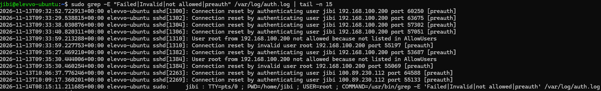
</details>

> ✍️ **My explanation:**
> _Guide questions:_
> - Why is "SSH only on a VPN" safer than "SSH open with keys"?
> - What is the difference between `ssh.socket` and `ssh.service`?
> - What happens if Tailscale goes down? How would you get back in? (Proxmox console)
> - Why do you need two layers here (`ListenAddress` AND the UFW rule)?

---

## What I learned

### SSH broke after a reboot (boot race)

After a reboot, `ssh elevvo` failed with **Connection refused**. That was a useful clue: "timed out" means nothing answered (like the LAN IP after the firewall change), but "refused" means the VM answered over Tailscale and nothing was listening on port 22. So the network was fine and `sshd` was the problem.

I got in through the **Proxmox Console** (it does not need SSH) and ran `systemctl status ssh`. `sshd` had failed with "Cannot assign requested address". It had started before Tailscale gave the VM its `100.89.28.19` IP, so it could not bind to it, and it gave up. My `After=tailscaled.service` override did not help, because it only waits for the `tailscaled` service to start, not for the IP to be ready. Restarting `ssh` got me back in for now.

The permanent fix is `net.ipv4.ip_nonlocal_bind = 1` ([step 5 of the Bonus](#steps-1)). It lets `sshd` bind to the Tailscale IP before the IP exists, so SSH comes up on every boot. After another reboot, `ssh elevvo` connected right away.

Lesson: always test a reboot after changing how a service starts, and keep a way in that does not depend on that service (here, the Proxmox Console).

> ✍️ **My explanation:**
> _Guide questions:_
> - What was the hardest part, and how did you figure it out?
> - What surprised you (for example, the cloud-init drop-in overriding your setting)?
> - What is one habit you will keep (snapshots, `sshd -t`, second session)?
