# Task 2: Nginx Reverse Proxy with HTTPS

## Goal

Put the Task 1 web app behind Nginx and serve it over HTTPS:

1. Nginx as a reverse proxy to the app on a local port.
2. UFW set to default deny, allowing only what is needed (HTTP, HTTPS, SSH).
3. A Let's Encrypt certificate that renews by itself.
4. **Bonus:** a permanent HTTP to HTTPS redirect, and hide the Nginx version.

> ✍️ **My explanation:**
> _Guide questions:_
> - What is a reverse proxy, in your own words?
> - Why put Nginx in front of the app instead of exposing the app directly?

---

## Environment

| Item | Value |
|---|---|
| VM | `elevvo-ubuntu`, Ubuntu 24.04.5 LTS (from [Task 0](../task-0-environment/README.md)) |
| App | Task 1 `webapp.service`, now on `127.0.0.1:8080` ([Task 1](../task-1-bastion/README.md)) |
| Domain | `lab.gbertpilapil.com` (DNS on Cloudflare) |
| Public access | Cloudflare Tunnel `lab` (`cloudflared` on the same VM) |
| Certificate | Let's Encrypt, ECDSA, issued with DNS-01 (`certbot` + `dns-cloudflare` plugin) |
| Home internet | Converge, behind CGNAT |

Config files used in this task are in [configs/](configs/).

---

## Architecture

```text
Browser
   |
   v
Cloudflare (DNS + edge for lab.gbertpilapil.com)
   |
   v
Cloudflare Tunnel "lab"   (outbound connection started by cloudflared on the VM)
   |
   v
Nginx :443  (Let's Encrypt cert for lab.gbertpilapil.com)
   |
   v
webapp on 127.0.0.1:8080  (Task 1 python http.server)
```

### Why DNS challenge + tunnel

My home internet is behind **CGNAT** (Converge). That means my router does not have its own public IP, so:

- **No inbound ports can be opened.** Port forwarding on my router does nothing, because the ISP's NAT sits in front of it.
- **The normal Let's Encrypt HTTP check (HTTP-01) cannot work.** Let's Encrypt needs to reach `http://lab.gbertpilapil.com/.well-known/...` on port 80, and it can't get in.

So I made two deliberate choices:

1. **DNS-01 for the certificate.** Instead of reaching my server, Let's Encrypt asks me to put a TXT record in DNS. Certbot's `dns-cloudflare` plugin does this with a Cloudflare API token. No inbound connection needed.
2. **Cloudflare Tunnel for public access.** `cloudflared` on the VM makes an **outbound** connection to Cloudflare. Visitors hit Cloudflare, and Cloudflare sends the request down that tunnel to Nginx. No ports open on my router.

The tunnel sends traffic to `https://localhost:443` and **checks the Let's Encrypt cert** (No TLS Verify is OFF). So the traffic is encrypted all the way to Nginx, not just to Cloudflare.

> ✍️ **My explanation:**
> _Guide questions:_
> - What is CGNAT, and how did you find out you were behind it?
> - What is the difference between the HTTP-01 and DNS-01 challenges?
> - Why does a tunnel work when port forwarding does not?

---

## Steps

### 1. Move the app to localhost only

In `/etc/systemd/system/webapp.service`, the app now binds to `127.0.0.1` only:

```bash
jibi@elevvo-ubuntu:~$ systemctl cat webapp | grep ExecStart
ExecStart=/usr/bin/python3 -m http.server 8080 --bind 127.0.0.1
```

<details><summary>Screenshot</summary>

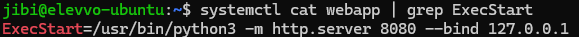
</details>

Then `sudo systemctl daemon-reload && sudo systemctl restart webapp`. Now Nginx is the only way in:

```bash
jibi@elevvo-ubuntu:~$ sudo ss -tlnp | grep 8080
LISTEN 0      5      127.0.0.1:8080      0.0.0.0:*    users:(("python3",pid=2830,fd=3))
```

<details><summary>Screenshot</summary>

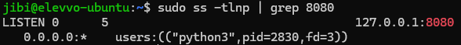
</details>

> ✍️ **My explanation:**
> _Guide questions:_
> - What is the difference between listening on `0.0.0.0` and `127.0.0.1`?

---

### 2. Nginx reverse proxy

Site config `/etc/nginx/sites-available/lab`, linked into `sites-enabled/`. This is the first version, before certbot (the final file is in [step 5](#5-get-the-certificate-dns-01) and [configs/nginx-lab.conf](configs/nginx-lab.conf)):

```nginx
server {
        listen 80;
        server_name lab.gbertpilapil.com;

        location / {
                proxy_pass http://127.0.0.1:8080;
                proxy_set_header Host $host;
                proxy_set_header X-Real-IP $remote_addr;
                proxy_set_header X-Forwarded-For $proxy_add_x_forwarded_for;
                proxy_set_header X-Forwarded-Proto $scheme;
        }
}
```

Test the config, reload, and check that Nginx passes the request to the app:

```bash
jibi@elevvo-ubuntu:~$ sudo nginx -t && sudo systemctl reload nginx
nginx: the configuration file /etc/nginx/nginx.conf syntax is ok
nginx: configuration file /etc/nginx/nginx.conf test is successful
jibi@elevvo-ubuntu:~$ curl -s -H "Host: lab.gbertpilapil.com" http://localhost
<h1>Elevvo Task 1: served by systemd</h1>
```

<details><summary>Screenshot</summary>

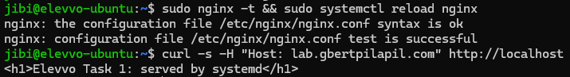
</details>

> ✍️ **My explanation:**
> _Guide questions:_
> - What does `proxy_pass` do?
> - Why send the `Host` and `X-Forwarded-*` headers to the app?
> - Why run `nginx -t` before `reload`?

---

### 3. Firewall (UFW)

Default deny incoming, allow outgoing. Allowed `Nginx Full` (80 and 443) and deleted the old Task 1 `8080/tcp` rule, since the app is now only on localhost.

```bash
jibi@elevvo-ubuntu:~$ sudo ufw status verbose
Status: active
Logging: on (low)
Default: deny (incoming), allow (outgoing), disabled (routed)
New profiles: skip

To                         Action      From
--                         ------      ----
22/tcp on tailscale0       ALLOW IN    Anywhere
80,443/tcp (Nginx Full)    ALLOW IN    Anywhere
22/tcp (v6) on tailscale0  ALLOW IN    Anywhere (v6)
80,443/tcp (Nginx Full (v6)) ALLOW IN  Anywhere (v6)
```

```bash
jibi@elevvo-ubuntu:~$ sudo ufw status numbered
Status: active

     To                         Action      From
     --                         ------      ----
[ 1] 22/tcp on tailscale0       ALLOW IN    Anywhere
[ 2] Nginx Full                 ALLOW IN    Anywhere
[ 3] 22/tcp (v6) on tailscale0  ALLOW IN    Anywhere (v6)
[ 4] Nginx Full (v6)            ALLOW IN    Anywhere (v6)
```

<details><summary>Screenshot</summary>

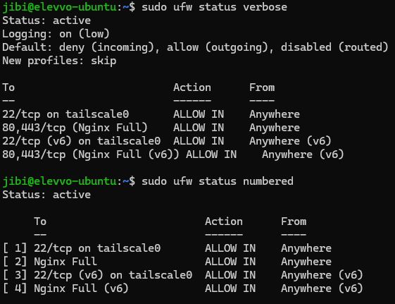
</details>

**About SSH:** I did **not** add an `OpenSSH` rule. SSH stays allowed only on `tailscale0`, from the [Task 1 bonus](../task-1-bastion/README.md#bonus-ssh-only-over-tailscale), and `sshd` only listens on the Tailscale IP. This still meets the "allow SSH" requirement, just tighter: SSH is reachable from my own devices, not from the whole internet.

> ✍️ **My explanation:**
> _Guide questions:_
> - Why is 8080 no longer needed in the firewall?
> - Ports 80 and 443 are open, but with CGNAT, can the internet actually reach them? Why keep them open anyway?

---

### 4. Cloudflare API token for certbot

Made a Cloudflare API token from the **Edit zone DNS** template:

- Permission: `Zone > DNS > Edit` only
- Zone: `gbertpilapil.com` only

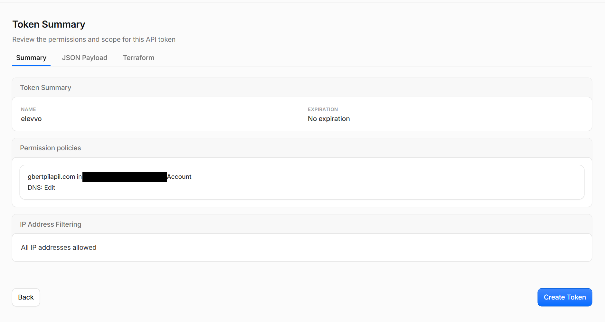

Saved it in `/etc/letsencrypt/cloudflare.ini` (the token is not shown here) and locked it to root only:

```bash
jibi@elevvo-ubuntu:~$ ls -l /etc/letsencrypt/cloudflare.ini
-rw------- 1 root root 82 Nov 14 13:27 /etc/letsencrypt/cloudflare.ini
```

<details><summary>Screenshot</summary>

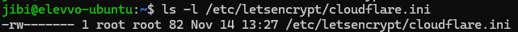
</details>

> ✍️ **My explanation:**
> _Guide questions:_
> - Why limit the token to one zone and DNS edit only?
> - What could someone do with this token if the file were world readable?

---

### 5. Get the certificate (DNS-01)

Issued with `certbot run -a dns-cloudflare -i nginx`: the `dns-cloudflare` plugin proves I own the domain through DNS, and the `nginx` installer edits the site config to use the cert.

```bash
jibi@elevvo-ubuntu:~$ sudo certbot certificates
Found the following certs:
  Certificate Name: lab.gbertpilapil.com
    Serial Number: 61a7aa08df165e7aaf9fceb123c70d7463c
    Key Type: ECDSA
    Domains: lab.gbertpilapil.com
    Expiry Date: 2027-02-12 12:31:57+00:00 (VALID: 89 days)
    Certificate Path: /etc/letsencrypt/live/lab.gbertpilapil.com/fullchain.pem
    Private Key Path: /etc/letsencrypt/live/lab.gbertpilapil.com/privkey.pem
```

<details><summary>Screenshot</summary>

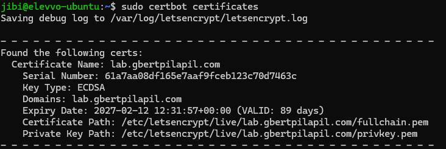
</details>

Lines certbot added to the Nginx site:

```bash
jibi@elevvo-ubuntu:~$ sudo grep -n "ssl_certificate\|listen 443\|return 301" /etc/nginx/sites-available/lab
12:    listen 443 ssl; # managed by Certbot
13:    ssl_certificate /etc/letsencrypt/live/lab.gbertpilapil.com/fullchain.pem; # managed by Certbot
14:    ssl_certificate_key /etc/letsencrypt/live/lab.gbertpilapil.com/privkey.pem; # managed by Certbot
21:        return 301 https://$host$request_uri;
```

<details><summary>Screenshot</summary>

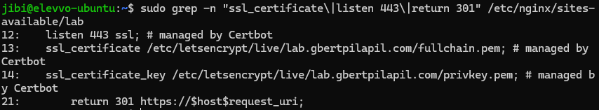
</details>

The full file after certbot ([configs/nginx-lab.conf](configs/nginx-lab.conf)):

```bash
jibi@elevvo-ubuntu:~$ cat /etc/nginx/sites-available/lab
server {
        server_name lab.gbertpilapil.com;

        location / {
                proxy_pass http://127.0.0.1:8080;
                proxy_set_header Host $host;
                proxy_set_header X-Real-IP $remote_addr;
                proxy_set_header X-Forwarded-For $proxy_add_x_forwarded_for;
                proxy_set_header X-Forwarded-Proto $scheme;
        }

    listen 443 ssl; # managed by Certbot
    ssl_certificate /etc/letsencrypt/live/lab.gbertpilapil.com/fullchain.pem; # managed by Certbot
    ssl_certificate_key /etc/letsencrypt/live/lab.gbertpilapil.com/privkey.pem; # managed by Certbot
    include /etc/letsencrypt/options-ssl-nginx.conf; # managed by Certbot
    ssl_dhparam /etc/letsencrypt/ssl-dhparams.pem; # managed by Certbot

}
server {
    if ($host = lab.gbertpilapil.com) {
        return 301 https://$host$request_uri;
    } # managed by Certbot


        listen 80;
        server_name lab.gbertpilapil.com;
    return 404; # managed by Certbot
}
```

Certbot moved my block to `listen 443 ssl`, and added a new port 80 block that sends `lab.gbertpilapil.com` to HTTPS and gives `404` to any other name.

<details><summary>Screenshot</summary>

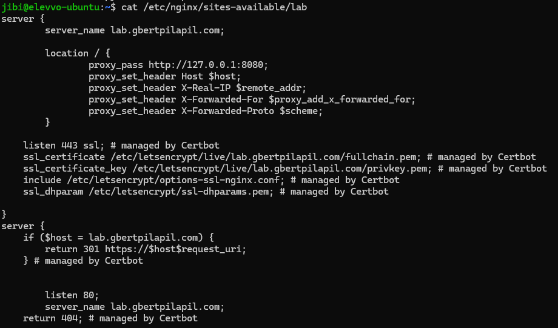
</details>

> ✍️ **My explanation:**
> _Guide questions:_
> - What are `fullchain.pem` and `privkey.pem`? Which one must stay secret?
> - Why ECDSA instead of RSA?
> - Why does Let's Encrypt only give 90 day certs?

---

### 6. Auto renewal

The `certbot.timer` systemd timer runs renewal twice a day. A dry run proves renewal works end to end (including the DNS step):

```bash
jibi@elevvo-ubuntu:~$ systemctl list-timers | grep certbot
Sun 2026-11-15 11:58:52 UTC   22h  -   -   certbot.timer   certbot.service
jibi@elevvo-ubuntu:~$ sudo certbot renew --dry-run
Processing /etc/letsencrypt/renewal/lab.gbertpilapil.com.conf
Account registered.
Simulating renewal of an existing certificate for lab.gbertpilapil.com
Waiting 10 seconds for DNS changes to propagate

Congratulations, all simulated renewals succeeded:
  /etc/letsencrypt/live/lab.gbertpilapil.com/fullchain.pem (success)
```

<details><summary>Screenshot</summary>

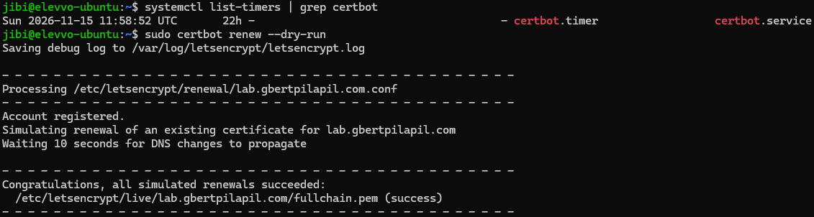
</details>

> ✍️ **My explanation:**
> _Guide questions:_
> - What is a systemd timer, compared to cron?
> - Why test with `--dry-run` instead of waiting for a real renewal?

---

### 7. Cloudflare Tunnel

Created a tunnel named `lab` in the Cloudflare dashboard and installed `cloudflared` on the VM as a systemd service. The tunnel token is kept in `/etc/cloudflared/token` (not shown).

The tunnel is up with one replica (`elevvo-ubuntu`) and status **Healthy**. This was taken before adding the route, so Routes shows `0`. The origin IP is my public IP, so it is blacked out.

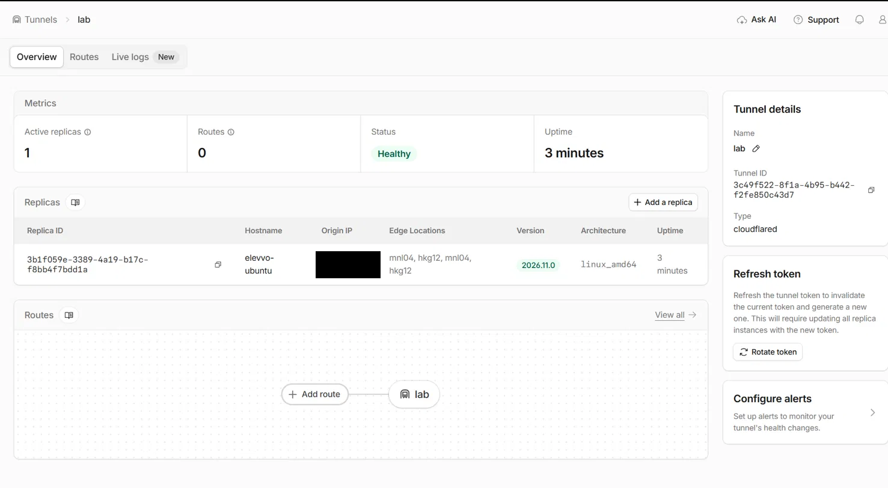

Published application route:

| Setting | Value |
|---|---|
| Hostname | `lab.gbertpilapil.com` |
| Service URL | `https://localhost:443` |
| TLS > Origin Server Name | `lab.gbertpilapil.com` |
| TLS > Disable TLS certificate verification | **OFF** (the tunnel checks the real Let's Encrypt cert) |

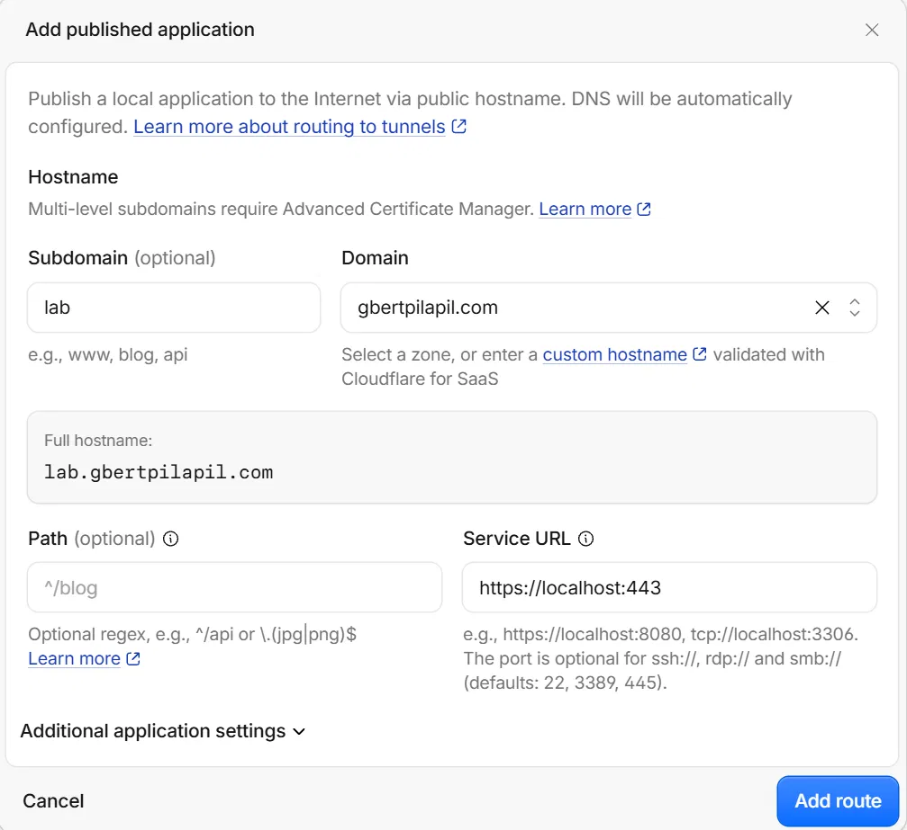

Origin Server Name is needed because the tunnel connects to `localhost`, but the cert is for `lab.gbertpilapil.com`. This tells the tunnel which name to expect on the cert.

<details><summary>Screenshots: TLS settings</summary>

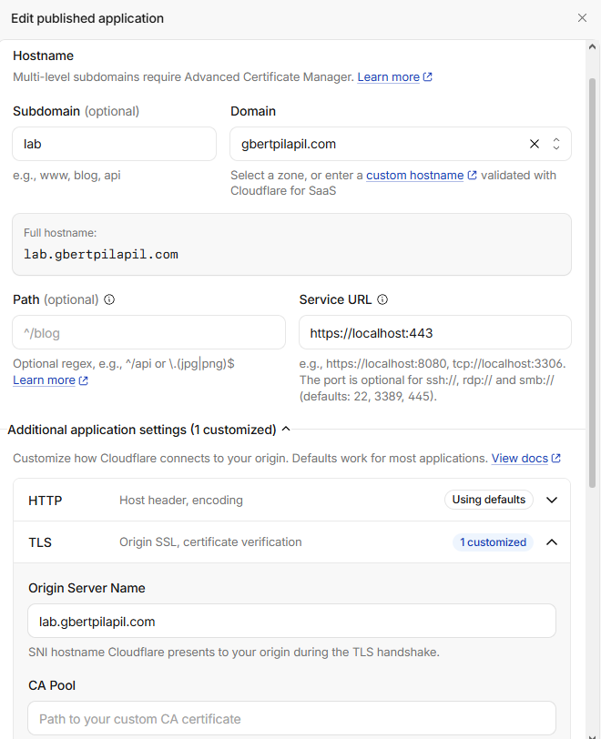
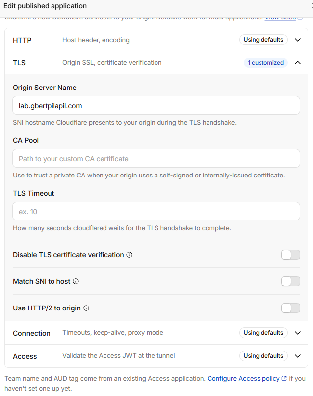
</details>

```bash
jibi@elevvo-ubuntu:~$ systemctl status cloudflared --no-pager
● cloudflared.service - Cloudflare Tunnel client
     Loaded: loaded (/etc/systemd/system/cloudflared.service; enabled; preset: enabled)
     Active: active (running) since Sat 2026-11-14 13:39:45 UTC; 17s ago
   Main PID: 4960 (cloudflared)
     CGroup: /system.slice/cloudflared.service
             └─4960 /usr/bin/cloudflared --no-autoupdate tunnel run --token-file /etc/cloudflared/token
... INF |  SUMMARY: Environment is healthy. cloudflared will use 'qui…tocol.  |
... INF precheck component="DNS Resolution" details="DNS Resolved suc…
... INF precheck component="UDP Connectivity" details="QUIC connectio…
... INF precheck component="TCP Connectivity" details="HTTP/2 connect…
... INF precheck component="Cloudflare API" details="API is reachable…
... INF precheck complete hard_fail=false ...
```

<details><summary>Screenshot</summary>

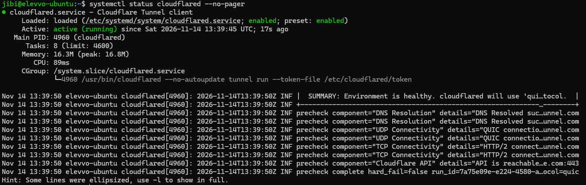
</details>

After saving the route in the dashboard, `cloudflared` picked up the new config by itself:

```text
Nov 14 13:44:33 elevvo-ubuntu cloudflared[4960]: ... INF Updated to new configuration config="{\"ingress\":[{\"hostname\":\"lab.gber…
```

<details><summary>Screenshot</summary>

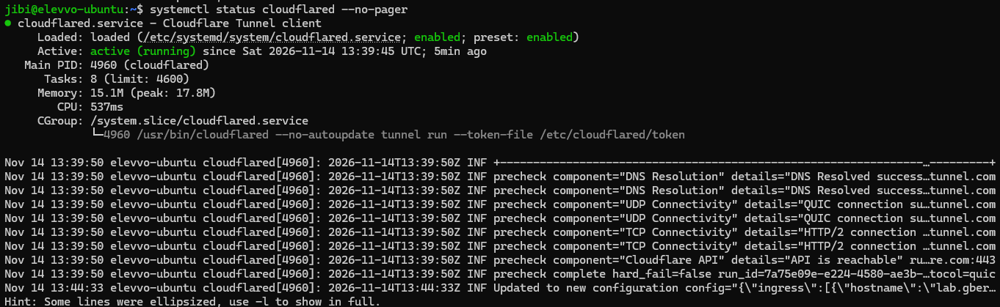
</details>

> ✍️ **My explanation:**
> _Guide questions:_
> - Why point the tunnel at `https://localhost:443` and not straight at `127.0.0.1:8080`?
> - What would "No TLS Verify ON" mean, and why is OFF safer?
> - Why use `--token-file` instead of putting the token on the command line?

---

## Proof

### HTTPS works with a trusted cert (from the laptop, on the LAN)

`--resolve` makes the domain point at the VM's LAN IP, so this tests Nginx directly. No `-k` flag, so Windows checked the cert and trusted it:

```text
PS> curl.exe -vI --resolve lab.gbertpilapil.com:443:192.168.100.203 https://lab.gbertpilapil.com
* Connected to lab.gbertpilapil.com (192.168.100.203) port 443
> HEAD / HTTP/1.1
> Host: lab.gbertpilapil.com
< HTTP/1.1 200 OK
< Server: nginx/1.24.0 (Ubuntu)
< Content-Type: text/html
< Content-Length: 42
< Last-Modified: Fri, 13 Nov 2026 09:41:10 GMT
```

This was before the bonus, so the Server header still shows the version (`nginx/1.24.0 (Ubuntu)`).

<details><summary>Screenshot</summary>

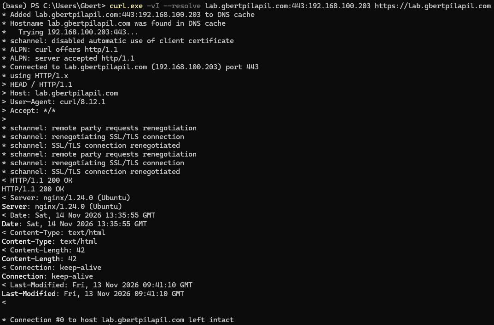
</details>

### Public site through the tunnel (phone)

Opened `lab.gbertpilapil.com` on my phone. The page loads over HTTPS through Cloudflare and the tunnel:

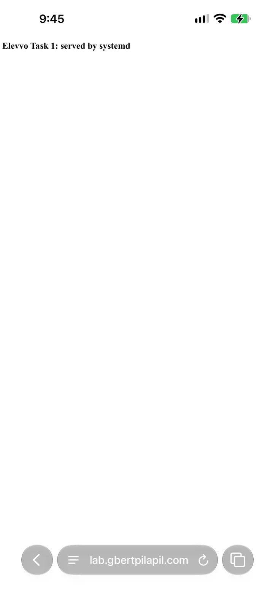

### Public site from the laptop

```text
PS> curl.exe -I http://lab.gbertpilapil.com
HTTP/1.1 200 OK
Date: Sat, 14 Nov 2026 14:11:41 GMT
Content-Type: text/html
Connection: keep-alive
last-modified: Fri, 13 Nov 2026 09:41:10 GMT
Server: cloudflare
cf-cache-status: DYNAMIC
CF-RAY: a5a69b5a7c03f6b0-MNL
...
```

`Server: cloudflare` and `CF-RAY` show the request went through Cloudflare, and `last-modified` matches the app's `index.html`, so it reached the app through the tunnel.

<details><summary>Screenshot</summary>

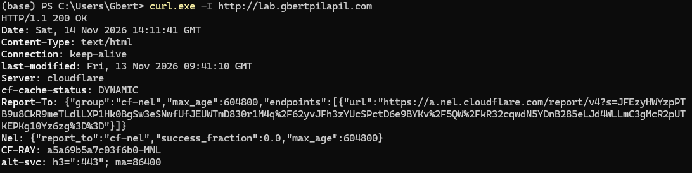
</details>

---

## Bonus: HTTP to HTTPS redirect, hide Nginx version

1. **Redirect:** certbot added a port 80 block with `return 301 https://$host$request_uri;` (line 21 in [step 5](#5-get-the-certificate-dns-01)). `301` means "moved permanently", so browsers remember it.
2. **Hide version:** set `server_tokens off;` in `/etc/nginx/nginx.conf`, then `sudo nginx -t && sudo systemctl reload nginx`.

```bash
jibi@elevvo-ubuntu:~$ grep server_tokens /etc/nginx/nginx.conf
        server_tokens off;
```

<details><summary>Screenshot</summary>

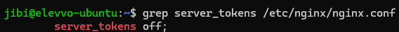
</details>

### Proof

```bash
jibi@elevvo-ubuntu:~$ curl -sI -H "Host: lab.gbertpilapil.com" http://localhost
HTTP/1.1 301 Moved Permanently
Server: nginx
Date: Sat, 14 Nov 2026 13:51:12 GMT
Content-Type: text/html
Content-Length: 162
Connection: keep-alive
Location: https://lab.gbertpilapil.com/

jibi@elevvo-ubuntu:~$ curl -skI --resolve lab.gbertpilapil.com:443:127.0.0.1 https://lab.gbertpilapil.com | grep -i server
Server: nginx
```

- HTTP gives `301` with `Location: https://...`.
- `Server: nginx` with no version, on both HTTP and HTTPS. Compare with `nginx/1.24.0 (Ubuntu)` in the [proof above](#https-works-with-a-trusted-cert-from-the-laptop-on-the-lan).

**Note on public traffic:** the redirect is done by Nginx and is proven here on the VM. Public visitors never reach Nginx's port 80 block, because the tunnel only ever sends traffic to Nginx over HTTPS (`https://localhost:443`). That is why the public `curl.exe -I http://lab.gbertpilapil.com` in [Public site from the laptop](#public-site-from-the-laptop) gets `200` from Cloudflare instead of `301`.

<details><summary>Screenshot</summary>

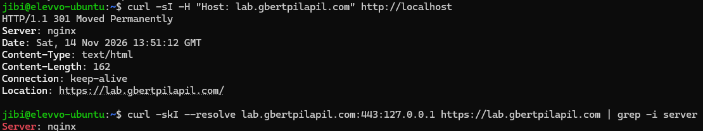
</details>

> ✍️ **My explanation:**
> _Guide questions:_
> - Why redirect HTTP to HTTPS instead of just closing port 80?
> - What is the difference between a `301` and a `302`?
> - Why does hiding the version help? Is it real security or just less info for attackers?

---

## What I learned

> ✍️ **My explanation:**
> _Guide questions:_
> - What was the hardest part (CGNAT, DNS-01, tunnel TLS settings), and how did you figure it out?
> - What would change if this VM had a real public IP?
> - What is one thing you would do differently next time?