# Task 3: Automated Log Backup with Cron and Safe Secrets

## Goal

Automate a maintenance job on the VM and keep it in Git safely:

1. A script that does a maintenance task: archive the Nginx logs from [Task 2](../task-2-reverse-proxy/README.md) into a compressed file.
2. Run it on a schedule with `cron`.
3. Put it in Git with strict secrets hygiene: real values only in an env file, never in the repo.
4. **Bonus:** call an external service (an n8n webhook that sends a Telegram message), with no hardcoded tokens.

I also followed the Module 3 rubric: Bash with `set -euo pipefail` and absolute paths, a Python script with `try/except` that reads a token from the environment, `cron.txt` with the exact cron entry, cron output sent to a log file, and a clean commit history.

> ✍️ **My explanation:**
> _Guide questions:_
> - Why automate backups instead of doing them by hand?
> - What is a "secret" in a repo, and what happens if one gets pushed to GitHub?

---

## Environment

| Item | Value |
|---|---|
| VM | `elevvo-ubuntu`, Ubuntu 24.04.5 LTS (from [Task 0](../task-0-environment/README.md)) |
| What gets backed up | `/var/log/nginx` (Nginx from [Task 2](../task-2-reverse-proxy/README.md)) |
| Backups go to | `/var/backups/lab` |
| Runs as | system user `logbackup` (no login shell, in group `adm`) |
| Schedule | daily at midnight, Asia/Manila time |
| Alerts | self-hosted n8n webhook, then Telegram |

### Files in this folder

| File | What it is | Installed on the VM at |
|---|---|---|
| [lab-backup.sh](lab-backup.sh) | The backup script (Bash) | `/usr/local/bin/lab-backup.sh` |
| [log_summary.py](log_summary.py) | Counts error lines in a log (Python) | `/usr/local/bin/log_summary.py` |
| [cron.txt](cron.txt) | Exact copy of the cron entry | `/etc/cron.d/lab-backup` |
| [lab-backup.env.example](lab-backup.env.example) | Env file with **fake** values | real one: `/etc/lab-backup/lab-backup.env` |
| [.gitignore](.gitignore) | Keeps secrets, archives and logs out of Git | |

---

## Steps

### 1. Git and GitHub on the VM

Set my Git name and email, and made a new SSH key just for GitHub (separate from the laptop key in Task 1):

```bash
jibi@elevvo-ubuntu:~$ git config --global user.name "Gbert Pilapil"
jibi@elevvo-ubuntu:~$ git config --global user.email "<my email>"
jibi@elevvo-ubuntu:~$ ssh-keygen -t ed25519 -C "lab-ubuntu-github"
Your identification has been saved in /home/jibi/.ssh/id_ed25519
Your public key has been saved in /home/jibi/.ssh/id_ed25519.pub
The key fingerprint is:
SHA256:qUpsQODuVHZ9SNRD8PX5/o7ZGgj4JkpmhWZUB54Oo5I lab-ubuntu-github
```

<details><summary>Screenshot</summary>

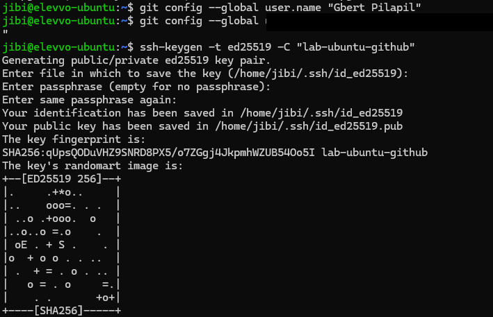
</details>

Added the `.pub` key to GitHub, then tested it:

```bash
jibi@elevvo-ubuntu:~$ ssh -T git@github.com
The authenticity of host 'github.com (20.6.7.17)' can't be established.
ED25519 key fingerprint is SHA256:+DiY3wvvV6TuJJhbpZisF/zLDA0zPMSvHdkr4UvCOqU.
Are you sure you want to continue connecting (yes/no/[fingerprint])? yes
Warning: Permanently added 'github.com' (ED25519) to the list of known hosts.
Enter passphrase for key '/home/jibi/.ssh/id_ed25519':
Hi jibi2n! You've successfully authenticated, but GitHub does not provide shell access.
```

<details><summary>Screenshot</summary>

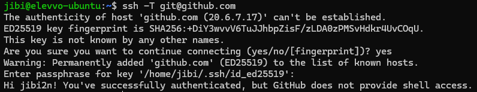
</details>

Cloned this repo onto the VM and made the task folder:

```bash
jibi@elevvo-ubuntu:~$ git clone git@github.com:jibi2n/elevvo-cloud-devops.git ~/elevvo-cloud-devops
Cloning into '/home/jibi/elevvo-cloud-devops'...
Receiving objects: 100% (92/92), 2.15 MiB | 1.64 MiB/s, done.
Resolving deltas: 100% (6/6), done.
jibi@elevvo-ubuntu:~$ mkdir -p ~/elevvo-cloud-devops/task-3-automation && cd $_
```

<details><summary>Screenshot</summary>

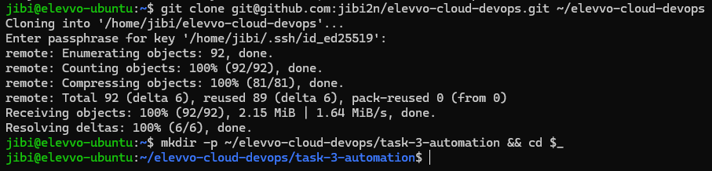
</details>

> ✍️ **My explanation:**
> _Guide questions:_
> - Why a separate SSH key for GitHub instead of reusing one?
> - What does `ssh -T git@github.com` prove?

---

### 2. Secrets hygiene first: `.gitignore` and the example env file

I made the `.gitignore` **before** writing any secrets, so a real env file can never be added by accident. Final version:

```gitignore
#secrets
*.env
.env
#never commit archives or logs
*.tar.gz
*.log

__pycache__/
```

<details><summary>Screenshot</summary>

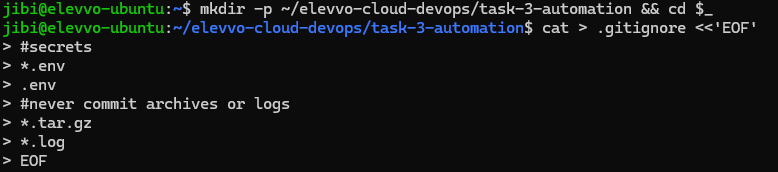
</details>

The repo only gets [lab-backup.env.example](lab-backup.env.example), with fake values. It shows which settings exist without showing the real ones:

```ini
SOURCE_DIR=/var/log/nginx
BACKUP_DIR=/var/backups/lab
RETENTION_DAYS=7
WEBHOOK_URL=https://n8n.example.com/webhook/lab-backup
WEBHOOK_TOKEN=change-me
API_TOKEN=change-me
LOG_FILE=/var/log/nginx/error.log
```

<details><summary>Screenshot (first version, before the Python settings were added)</summary>

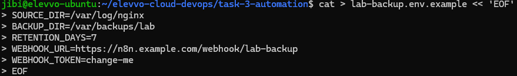
</details>

> ✍️ **My explanation:**
> _Guide questions:_
> - Why does `.env.example` end in `.example` and not `.env`? (Hint: look at the `.gitignore`.)
> - Why set up `.gitignore` before creating secrets, not after?

---

### 3. A service user: `logbackup`

The backup does not need root. It only needs to **read** `/var/log` and **write** to `/var/backups/lab`. So it runs as its own system user with no login shell. On Ubuntu, the `adm` group can read most logs in `/var/log`, so `logbackup` joins `adm` instead of using root.

```bash
jibi@elevvo-ubuntu:~$ getent passwd logbackup
logbackup:x:996:987::/home/logbackup:/usr/sbin/nologin
jibi@elevvo-ubuntu:~$ id logbackup
uid=996(logbackup) gid=987(logbackup) groups=987(logbackup),4(adm)
```

- UID below 1000 means a system account, not a person.
- Shell `/usr/sbin/nologin` means nobody can log in as it.
- Group `4(adm)` gives read access to logs.

<details><summary>Screenshot</summary>

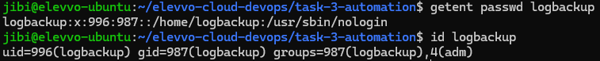
</details>

> ✍️ **My explanation:**
> _Guide questions:_
> - What is "least privilege", in your own words?
> - What could go wrong if this script ran as root?

---

### 4. The backup script: `lab-backup.sh`

Full script: [lab-backup.sh](lab-backup.sh). What each part does:

| Part | What it does |
|---|---|
| `set -euo pipefail` | Stop on any error (`-e`), on unset variables (`-u`), and if any command in a pipe fails (`pipefail`). |
| `source "$ENV_FILE"` | Loads settings and tokens from `/etc/lab-backup/lab-backup.env`. Nothing secret is written in the script. |
| `${SOURCE_DIR:-/var/log/nginx}` | Use the env file value, or this default if it is not set. All paths are absolute, because cron runs with a very small environment. |
| `stamp=$(date +%Y%m%d-%H%M%S)` | Date tag in the file name, e.g. `logs-elevvo-ubuntu-20261117-222228.tar.gz`. |
| `trap 'notify failure ...' ERR` | If any command fails, send a "failure" alert with the line number, before the script exits. |
| `flock -n 9` | Takes a lock file. If another run is still going, this one exits quietly, so two runs never overlap. |
| `tar -czf ... \|\| [[ $? -eq 1 ]]` | Makes the `.tar.gz`. Exit code 1 only means "a log file changed while reading", which is normal for live logs, so it is allowed. Any other error still fails. |
| `tar -tzf "$archive"` | Checks the archive can be opened. A backup you can't open is not a backup. |
| `find ... -mtime +"$RETENTION_DAYS" -delete` | Deletes archives older than 7 days, so the disk does not fill up. |
| `notify success ...` | Sends a "success" alert with the file name, size and how many archives are kept. |
| `curl ... -H "X-Backup-Token: $WEBHOOK_TOKEN"` | The webhook call. The token comes from the env file. If the webhook is down, it only logs "webhook call failed" and does not break the backup. |

Checked the syntax without running it:

```bash
jibi@elevvo-ubuntu:~/elevvo-cloud-devops/task-3-automation$ chmod +x lab-backup.sh
jibi@elevvo-ubuntu:~/elevvo-cloud-devops/task-3-automation$ bash -n lab-backup.sh && echo "syntax OK"
syntax OK
```

<details><summary>Screenshot</summary>

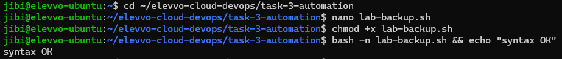
</details>

Then installed it to `/usr/local/bin/lab-backup.sh`, the standard place for scripts I add myself. The cron log in [step 6](#6-schedule-it-with-cron) shows cron running it from there.

> ✍️ **My explanation:**
> _Guide questions:_
> - What does each letter in `set -euo pipefail` protect against?
> - What is a `trap`, and why use it for the failure alert?
> - Why does the script need a lock (`flock`)?

---

### 5. The real env file and the first run

The real settings and tokens live in `/etc/lab-backup/lab-backup.env`:

- File: owner `root`, group `logbackup`, mode `640`. Root can edit it, `logbackup` can read it, everyone else gets nothing.
- Folder `/etc/lab-backup/`: mode `750`, so a normal user can't even list it.

```bash
jibi@elevvo-ubuntu:~/elevvo-cloud-devops/task-3-automation$ ls -l /etc/lab-backup/
ls: cannot open directory '/etc/lab-backup/': Permission denied
jibi@elevvo-ubuntu:~/elevvo-cloud-devops/task-3-automation$ sudo ls -l /etc/lab-backup/
total 4
-rw-r----- 1 root logbackup 196 Nov 17 22:22 lab-backup.env
```

<details><summary>Screenshot</summary>

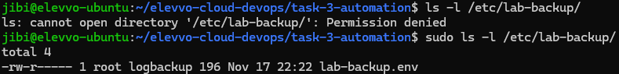
</details>

```bash
jibi@elevvo-ubuntu:~/elevvo-cloud-devops/task-3-automation$ sudo ls -ld /etc/lab-backup
drwxr-x--- 2 root logbackup 4096 Nov 17 22:22 /etc/lab-backup
```

`drwxr-x---` is `750`: root has full access, group `logbackup` can enter and read, others get nothing.

<details><summary>Screenshot</summary>

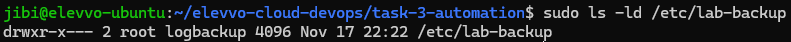
</details>

First manual run worked: one archive in `/var/backups/lab`, owned by `logbackup`. (Times here are UTC, because I had not changed the timezone yet. The env file was smaller then, 99 bytes, before I added the Python settings.)

```bash
jibi@elevvo-ubuntu:~/elevvo-cloud-devops/task-3-automation$ ls -lh /var/backups/lab
total 4.0K
-rw-rw-r-- 1 logbackup logbackup 940 Nov 17 13:46 logs-elevvo-ubuntu-20261117-134604.tar.gz
jibi@elevvo-ubuntu:~/elevvo-cloud-devops/task-3-automation$ sudo ls -l /etc/lab-backup/
total 4
-rw-r----- 1 root logbackup 99 Nov 17 13:44 lab-backup.env
```

<details><summary>Screenshot</summary>

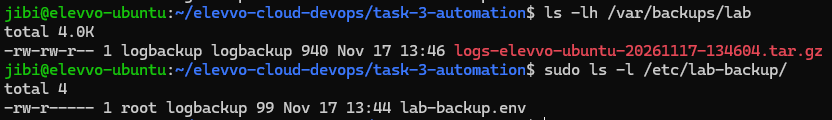
</details>

> ✍️ **My explanation:**
> _Guide questions:_
> - Read `-rw-r----- root logbackup` out loud: who can read, who can write?
> - Why put the real env file in `/etc` and not in the repo folder?

---

### 6. Schedule it with cron

**Timezone first.** The VM was on UTC, so "midnight" in cron would have been 8 AM in Manila. Cron uses the system timezone, so I changed it and restarted cron:

```bash
jibi@elevvo-ubuntu:~/elevvo-cloud-devops/task-3-automation$ sudo timedatectl set-timezone Asia/Manila
jibi@elevvo-ubuntu:~/elevvo-cloud-devops/task-3-automation$ sudo systemctl restart cron
jibi@elevvo-ubuntu:~/elevvo-cloud-devops/task-3-automation$ timedatectl
               Local time: Tue 2026-11-17 21:49:56 PST
           Universal time: Tue 2026-11-17 13:49:56 UTC
                 RTC time: Tue 2026-11-17 13:49:56
                Time zone: Asia/Manila (PST, +0800)
System clock synchronized: yes
              NTP service: active
          RTC in local TZ: no
```

<details><summary>Screenshot</summary>

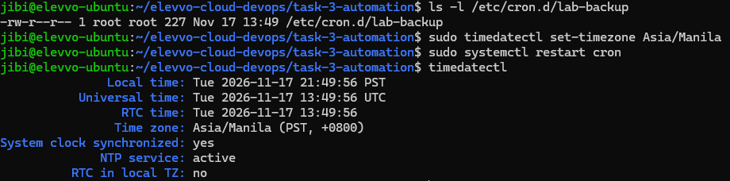
</details>

**Test with every 5 minutes.** I first set the schedule to `*/5 * * * *` in `/etc/cron.d/lab-backup` so I didn't have to wait until midnight. Cron ran it at 21:50, 21:55 and 22:00, and each run added one archive:

```bash
jibi@elevvo-ubuntu:~/elevvo-cloud-devops/task-3-automation$ journalctl -u cron --since "-15 min" --no-pager | grep lab-backup
Nov 17 21:50:01 elevvo-ubuntu CRON[1706]: (logbackup) CMD ( /usr/local/bin/lab-backup.sh >> /var/log/lab-backup/lab-backup.log 2>&1)
Nov 17 21:55:01 elevvo-ubuntu CRON[1751]: (logbackup) CMD ( /usr/local/bin/lab-backup.sh >> /var/log/lab-backup/lab-backup.log 2>&1)
Nov 17 22:00:01 elevvo-ubuntu CRON[1781]: (logbackup) CMD ( /usr/local/bin/lab-backup.sh >> /var/log/lab-backup/lab-backup.log 2>&1)
jibi@elevvo-ubuntu:~/elevvo-cloud-devops/task-3-automation$ tail -n 20 /var/log/lab-backup/lab-backup.log
2026-11-17 21:50:01 [lab-backup] archiving /var/log/nginx -> /var/backups/lab/logs-elevvo-ubuntu-20261117-215001.tar.gz
2026-11-17 21:50:01 [lab-backup] done: 4.0K, 2 archives kept
2026-11-17 21:55:01 [lab-backup] archiving /var/log/nginx -> /var/backups/lab/logs-elevvo-ubuntu-20261117-215501.tar.gz
2026-11-17 21:55:01 [lab-backup] done: 4.0K, 3 archives kept
2026-11-17 22:00:01 [lab-backup] archiving /var/log/nginx -> /var/backups/lab/logs-elevvo-ubuntu-20261117-220001.tar.gz
2026-11-17 22:00:01 [lab-backup] done: 4.0K, 4 archives kept
jibi@elevvo-ubuntu:~/elevvo-cloud-devops/task-3-automation$ ls -lh /var/backups/lab
total 16K
-rw-rw-r-- 1 logbackup logbackup 940 Nov 17 21:46 logs-elevvo-ubuntu-20261117-134604.tar.gz
-rw-rw-r-- 1 logbackup logbackup 940 Nov 17 21:50 logs-elevvo-ubuntu-20261117-215001.tar.gz
-rw-rw-r-- 1 logbackup logbackup 940 Nov 17 21:55 logs-elevvo-ubuntu-20261117-215501.tar.gz
-rw-rw-r-- 1 logbackup logbackup 940 Nov 17 22:00 logs-elevvo-ubuntu-20261117-220001.tar.gz
```

- `(logbackup)` shows cron ran it as `logbackup`, not root.
- `>> ... 2>&1` sends both normal output and errors to `/var/log/lab-backup/lab-backup.log`, so every run leaves a record.

<details><summary>Screenshot</summary>

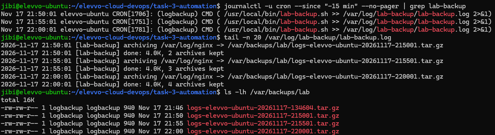
</details>

**Switch to midnight.** Then I changed the schedule to `0 0 * * *` (minute 0, hour 0, every day):

```text
SHELL=/bin/bash
PATH=/usr/local/sbin:/usr/local/bin:/usr/sbin:/usr/bin:/sbin:/bin
# m  h  dom mon dow  user       command
  0  0  *   *   *    logbackup  /usr/local/bin/lab-backup.sh >> /var/log/lab-backup/lab-backup.log 2>&1
```

<details><summary>Screenshot</summary>

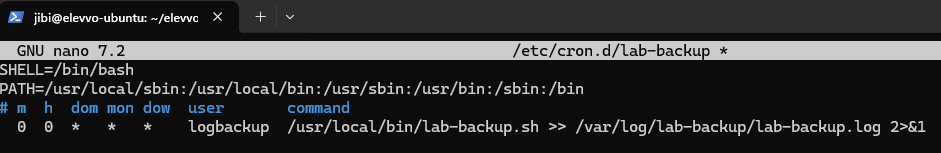
</details>

Files in `/etc/cron.d/` are a little different from a normal `crontab -e`: they have an extra **user** column (`logbackup`), and the file must end with a newline or cron ignores the last line.

Copied it into the repo as [cron.txt](cron.txt), so the exact entry is in Git:

```bash
jibi@elevvo-ubuntu:~/elevvo-cloud-devops/task-3-automation$ grep logbackup /etc/cron.d/lab-backup
  0  0  *   *   *    logbackup  /usr/local/bin/lab-backup.sh >> /var/log/lab-backup/lab-backup.log 2>&1
jibi@elevvo-ubuntu:~/elevvo-cloud-devops/task-3-automation$ cp /etc/cron.d/lab-backup ~/elevvo-cloud-devops/task-3-automation/cron.txt
```

<details><summary>Screenshot</summary>

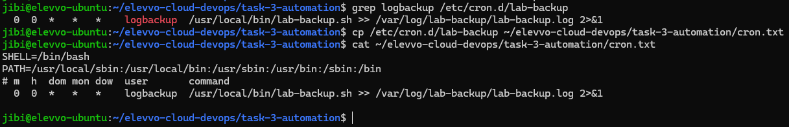
</details>

Final state: the cron file is owned by root and not writable by anyone else, and the timezone is still Manila:

```bash
jibi@elevvo-ubuntu:~/elevvo-cloud-devops/task-3-automation$ ls -l /etc/cron.d/lab-backup
-rw-r--r-- 1 root root 227 Nov 17 22:05 /etc/cron.d/lab-backup
jibi@elevvo-ubuntu:~/elevvo-cloud-devops/task-3-automation$ timedatectl
               Local time: Tue 2026-11-17 22:36:16 PST
           Universal time: Tue 2026-11-17 14:36:16 UTC
                Time zone: Asia/Manila (PST, +0800)
```

<details><summary>Screenshot</summary>

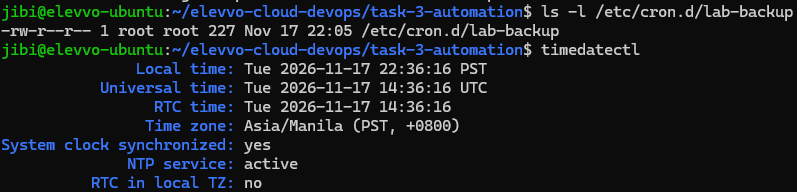
</details>

> ✍️ **My explanation:**
> _Guide questions:_
> - Read `0 0 * * *` field by field.
> - Why test with `*/5` first?
> - Why does cron need absolute paths and its own `PATH=` line?

---

### 7. Python script: `log_summary.py`

Full script: [log_summary.py](log_summary.py). It counts the lines with "error" in a log file (default `/var/log/nginx/error.log`).

| Part | What it does |
|---|---|
| `os.environ.get("API_TOKEN")` | Reads the token from the environment. It is never written in the code. |
| `if not API_TOKEN: ... return 1` | Refuses to run without a token, with a clear message. |
| `try / except FileNotFoundError / PermissionError` | A missing file or no permission gives a short, clear message and exit code 1, not a long Python crash. |
| `API_TOKEN[-4:]` | Only prints the last 4 characters, to show the token loaded without leaking it. |
| `return 0` / `return 1` | Exit codes, so cron or another script can tell if it worked. |

Tested three cases: normal run, missing file, and no token. (`demo-token-1234` is a fake test value, not a real token.)

```bash
jibi@elevvo-ubuntu:~/elevvo-cloud-devops/task-3-automation$ python3 -m py_compile log_summary.py && echo "syntax OK"
syntax OK
jibi@elevvo-ubuntu:~/elevvo-cloud-devops/task-3-automation$ sudo install -m 755 log_summary.py /usr/local/bin/log_summary.py
jibi@elevvo-ubuntu:~/elevvo-cloud-devops/task-3-automation$ sudo -u logbackup env API_TOKEN=demo-token-1234 /usr/bin/python3 /usr/local/bin/log_summary.py
File: /var/log/nginx/error.log
Lines: 1
ERROR lines: 0
Token loaded: yes (ends in ...1234)
jibi@elevvo-ubuntu:~/elevvo-cloud-devops/task-3-automation$ sudo -u logbackup env API_TOKEN=demo-token-1234 LOG_FILE=/nope /usr/bin/python3 /usr/local/bin/log_summary.py
Log file not found: /nope
jibi@elevvo-ubuntu:~/elevvo-cloud-devops/task-3-automation$ /usr/bin/python3 /usr/local/bin/log_summary.py
API_TOKEN is not set. Export it or put it in the env file.
```

<details><summary>Screenshot</summary>

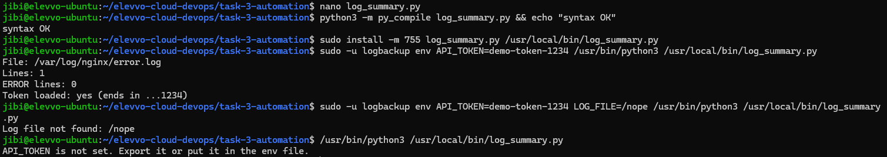
</details>

The real Nginx error log had no errors, so I also tested on a small sample log with 2 ERROR lines out of 4:

```bash
jibi@elevvo-ubuntu:~/elevvo-cloud-devops/task-3-automation$ printf 'INFO start\nERROR disk full\nINFO ok\nERROR timeout\n' > /tmp/sample.log
jibi@elevvo-ubuntu:~/elevvo-cloud-devops/task-3-automation$ cat /tmp/sample.log
INFO start
ERROR disk full
INFO ok
ERROR timeout
jibi@elevvo-ubuntu:~/elevvo-cloud-devops/task-3-automation$ API_TOKEN=demo-token-1234 LOG_FILE=/tmp/sample.log python3 /usr/local/bin/log_summary.py
File: /tmp/sample.log
Lines: 4
ERROR lines: 2
Token loaded: yes (ends in ...1234)
```

<details><summary>Screenshot</summary>

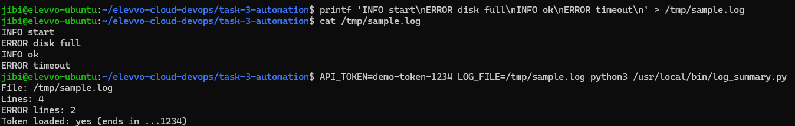
</details>

> ✍️ **My explanation:**
> _Guide questions:_
> - Why catch `FileNotFoundError` and `PermissionError` separately?
> - Why is it safe to print only the last 4 characters of a token?

---

### 8. Commit and push

Checked that the real env file would be ignored **before** adding anything:

```bash
jibi@elevvo-ubuntu:~/elevvo-cloud-devops/task-3-automation$ git check-ignore -v lab-backup.env
task-3-automation/.gitignore:2:*.env    lab-backup.env
```

This means line 2 of `.gitignore` (`*.env`) blocks `lab-backup.env`.

<details><summary>Screenshot</summary>

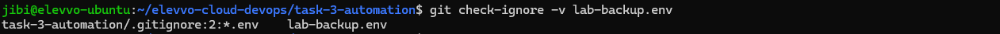
</details>

Added the files by name (not `git add .`), committed and pushed:

```bash
jibi@elevvo-ubuntu:~/elevvo-cloud-devops/task-3-automation$ git add .gitignore lab-backup.sh lab-backup.env.example cron.txt
jibi@elevvo-ubuntu:~/elevvo-cloud-devops/task-3-automation$ git commit -m "Task 3: log backup script with cron and env-based secrets added"
[main d1b96a2] Task 3: log backup script with cron and env-based secrets added
 4 files changed, 65 insertions(+)
 create mode 100644 task-3-automation/.gitignore
 create mode 100644 task-3-automation/cron.txt
 create mode 100644 task-3-automation/lab-backup.env.example
 create mode 100755 task-3-automation/lab-backup.sh
jibi@elevvo-ubuntu:~/elevvo-cloud-devops/task-3-automation$ git push
To github.com:jibi2n/elevvo-cloud-devops.git
   46ca792..d1b96a2  main -> main
jibi@elevvo-ubuntu:~/elevvo-cloud-devops/task-3-automation$ git log --oneline -n 5
d1b96a2 (HEAD -> main, origin/main, origin/HEAD) Task 3: log backup script with cron and env-based secrets added
46ca792 added task 2 stuff, and added a failure I saw in task 1, explanations to follow
12b7c40 added task 1 stuff, but explanations are not finished yet
79dc720 added task 0 and task 1 writeups, no explanations yet
d1ded0d added task 0 docs
```

`100755` on `lab-backup.sh` means Git kept the "executable" bit. Later, `log_summary.py` went in as its own commit (`9e8e228 Task 3: add Python log summary`).

<details><summary>Screenshot</summary>

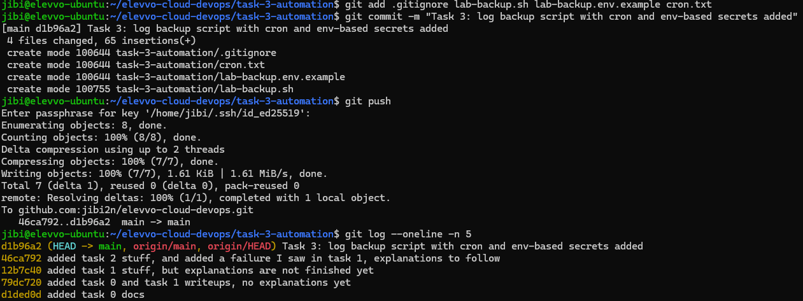
</details>

The only `TOKEN=` in the script is the line that reads it from the environment:

```bash
jibi@elevvo-ubuntu:~/elevvo-cloud-devops/task-3-automation$ grep -rn "TOKEN=" . --include=*.sh
./lab-backup.sh:12:WEBHOOK_TOKEN="${WEBHOOK_TOKEN:-}"
```

<details><summary>Screenshot</summary>

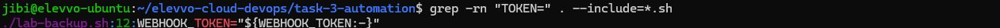
</details>

On GitHub, the folder has only the safe files:

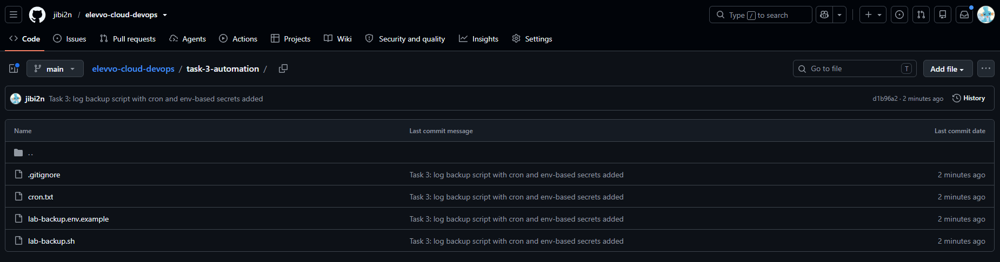

> ✍️ **My explanation:**
> _Guide questions:_
> - Why add files by name instead of `git add .`?
> - What does `git check-ignore -v` tell you?

---

## Proof

### Backups pile up, one per run

```bash
jibi@elevvo-ubuntu:~/elevvo-cloud-devops/task-3-automation$ ls -lh /var/backups/lab
total 32K
-rw-rw-r-- 1 logbackup logbackup 940 Nov 17 21:46 logs-elevvo-ubuntu-20261117-134604.tar.gz
-rw-rw-r-- 1 logbackup logbackup 940 Nov 17 21:50 logs-elevvo-ubuntu-20261117-215001.tar.gz
-rw-rw-r-- 1 logbackup logbackup 940 Nov 17 21:55 logs-elevvo-ubuntu-20261117-215501.tar.gz
-rw-rw-r-- 1 logbackup logbackup 940 Nov 17 22:00 logs-elevvo-ubuntu-20261117-220001.tar.gz
-rw-rw-r-- 1 logbackup logbackup 940 Nov 17 22:14 logs-elevvo-ubuntu-20261117-221444.tar.gz
-rw-rw-r-- 1 logbackup logbackup 940 Nov 17 22:15 logs-elevvo-ubuntu-20261117-221510.tar.gz
-rw-rw-r-- 1 logbackup logbackup 940 Nov 17 22:21 logs-elevvo-ubuntu-20261117-222110.tar.gz
-rw-rw-r-- 1 logbackup logbackup 940 Nov 17 22:22 logs-elevvo-ubuntu-20261117-222228.tar.gz
```

The first one says `134604` in its name (made at 13:46 UTC) but shows `21:46` now, because `ls` shows times in the new Manila timezone. Same moment, different clock.

<details><summary>Screenshot</summary>

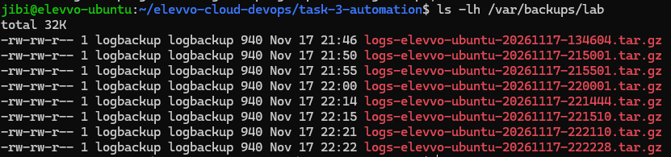
</details>

### Secrets never reached Git

Only the 5 safe files are tracked:

```bash
jibi@elevvo-ubuntu:~/elevvo-cloud-devops/task-3-automation$ git ls-files
.gitignore
cron.txt
lab-backup.env.example
lab-backup.sh
log_summary.py
```

<details><summary>Screenshot</summary>

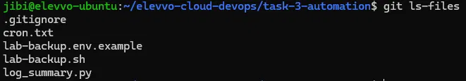
</details>

Searched **all of Git history** for the real webhook token. The token goes into a shell variable straight from the env file, so it is never printed on screen:

```bash
jibi@elevvo-ubuntu:~/elevvo-cloud-devops/task-3-automation$ TOKEN=$(sudo grep '^WEBHOOK_TOKEN=' /etc/lab-backup/lab-backup.env | cut -d= -f2-)
jibi@elevvo-ubuntu:~/elevvo-cloud-devops/task-3-automation$ git log -p --all | grep -cF "$TOKEN"
0
jibi@elevvo-ubuntu:~/elevvo-cloud-devops/task-3-automation$ unset TOKEN
```

`0` matches in every commit on every branch. (The "Command 'log' not found" lines in the screenshot are a leftover from a mistake, see [What I learned](#what-i-learned).)

<details><summary>Screenshot</summary>

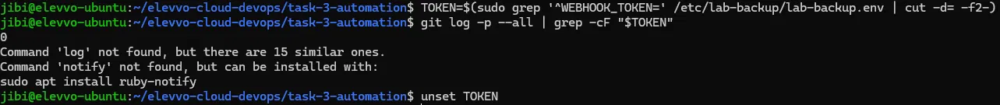
</details>

Working tree is clean and in sync with GitHub:

```bash
jibi@elevvo-ubuntu:~/elevvo-cloud-devops/task-3-automation$ git status
On branch main
Your branch is up to date with 'origin/main'.

nothing to commit, working tree clean
jibi@elevvo-ubuntu:~/elevvo-cloud-devops/task-3-automation$ grep pycache .gitignore
__pycache__/
```

<details><summary>Screenshot</summary>

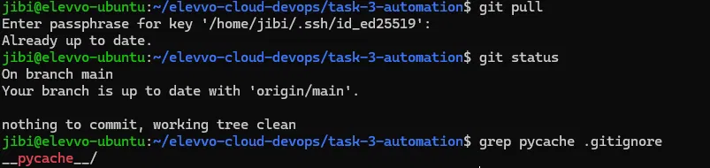
</details>

---

## Bonus: n8n webhook to Telegram

The script tells me how each backup went, on my phone.

```text
lab-backup.sh  --POST JSON + X-Backup-Token header-->  n8n Webhook  -->  Telegram message
```

**n8n workflow "Elevvo Lab Backup Alerts"** (on my self-hosted n8n):

1. **Webhook** node: `POST /webhook/lab-backup`, with **Header Auth**. n8n only accepts the request if the `X-Backup-Token` header matches the token stored in n8n. Anyone else gets rejected.
2. **Telegram** node: sends `Backup <status> on <host>: <message>`, using the `status`, `host` and `message` fields from the JSON the script sends.

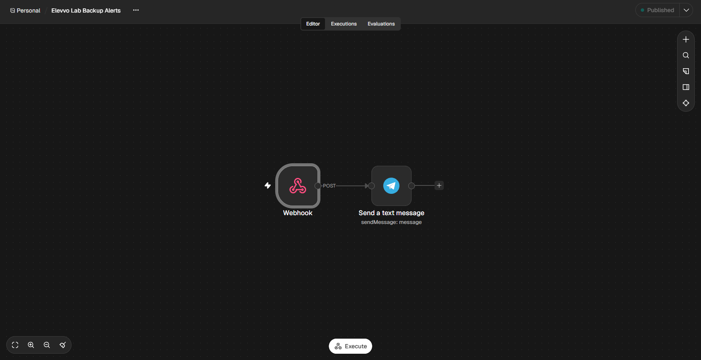

**No hardcoded tokens.** The webhook URL and token live only in `/etc/lab-backup/lab-backup.env` on the VM. The script reads them as `$WEBHOOK_URL` and `$WEBHOOK_TOKEN`, and the repo only has `change-me`. The Telegram bot token and chat ID are stored in n8n, not on the VM at all.

### Proof: success and failure

A normal run sends "success". To test failure, I made the backup folder read-only (`chmod 555`) so `tar` can't write the archive, ran it, then put the folder back (`chmod 755`):

```bash
jibi@elevvo-ubuntu:~/elevvo-cloud-devops/task-3-automation$ sudo -u logbackup /usr/local/bin/lab-backup.sh
2026-11-17 22:22:28 [lab-backup] archiving /var/log/nginx -> /var/backups/lab/logs-elevvo-ubuntu-20261117-222228.tar.gz
2026-11-17 22:22:28 [lab-backup] done: 4.0K, 8 archives kept
jibi@elevvo-ubuntu:~/elevvo-cloud-devops/task-3-automation$ sudo chmod 555 /var/backups/lab
jibi@elevvo-ubuntu:~/elevvo-cloud-devops/task-3-automation$ sudo -u logbackup /usr/local/bin/lab-backup.sh
2026-11-17 22:24:44 [lab-backup] archiving /var/log/nginx -> /var/backups/lab/logs-elevvo-ubuntu-20261117-222444.tar.gz
jibi@elevvo-ubuntu:~/elevvo-cloud-devops/task-3-automation$ sudo chmod 755 /var/backups/lab
```

The failed run stops right after "archiving", with no "done" line.

<details><summary>Screenshot</summary>

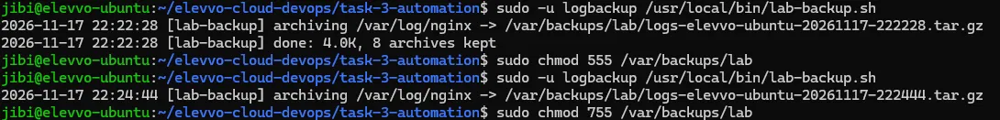
</details>

Both alerts arrived on Telegram:

```text
Backup success on elevvo-ubuntu: logs-elevvo-ubuntu-20261117-222228.tar.gz (4.0K), 8 kept      10:22 pm
Backup failure on elevvo-ubuntu: backup failed at line 35                                        10:24 pm
```

Line 35 of [lab-backup.sh](lab-backup.sh) is the `tar -czf` line, so the `trap ... ERR` pointed at exactly what broke.

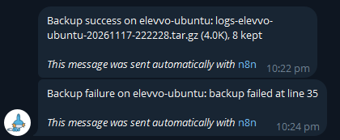

> ✍️ **My explanation:**
> _Guide questions:_
> - Why protect the webhook with a header token? What could someone do with an open webhook?
> - Why should a failed webhook call not fail the backup itself?
> - Why test the failure path on purpose?

---

## What I learned

- **Pasting a script into a live shell is not the same as running the script.** I pasted lines to test them. `set -euo pipefail` then applied to my own login shell, so the first error logged me out. A pasted `trap ... ERR` line also stayed active and kept firing on later mistakes, which is where the "Command 'log' not found / 'notify' not found" lines in the [history search screenshot](screenshots/22-history-token-search.png) came from. Scripts go in files.
- **n8n has two webhook URLs.** The test URL (`/webhook-test/...`) only works while the editor is listening. The published workflow uses `/webhook/...`. Using the wrong one gave me a 404.
- **cron.d files are picky.** They need the user field, need a newline at the end, and use the system timezone.
- **`useradd` with a wrong shell path only warns.** I typed `/usr/bin/nologin`, which does not exist on Ubuntu. `useradd` made the user anyway with just a warning. I fixed it with `usermod --shell /usr/sbin/nologin logbackup`, which is what `getent` shows in [step 3](#3-a-service-user-logbackup).

> ✍️ **My explanation:**
> _Guide questions:_
> - What was the hardest part, and how did you figure it out?
> - What would you add to make this production ready (off-site copy, restore test, monitoring)?