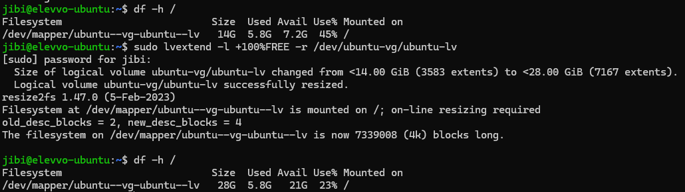
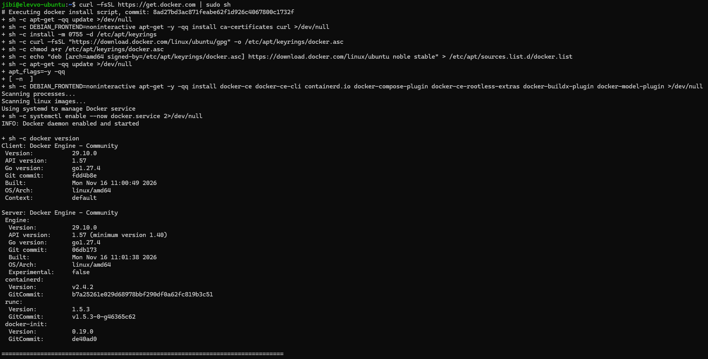
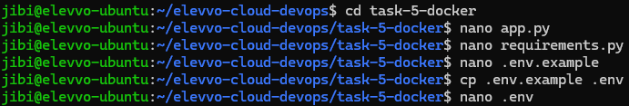
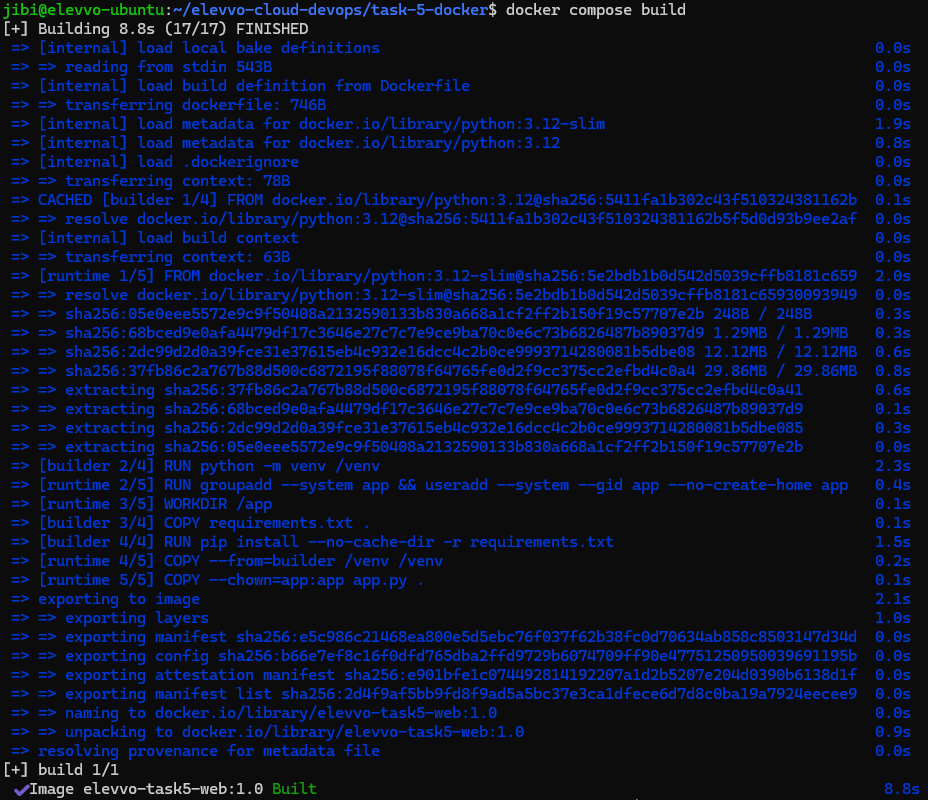
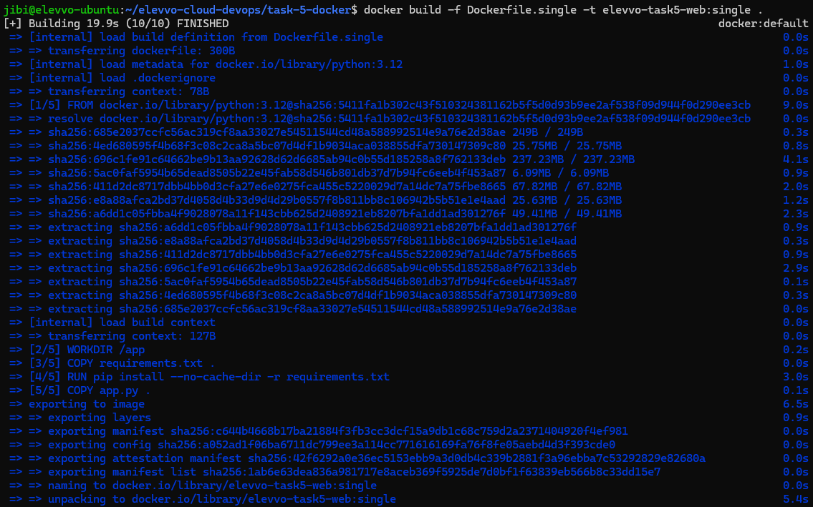
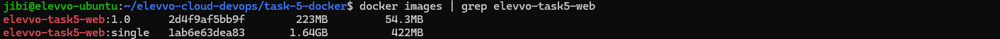
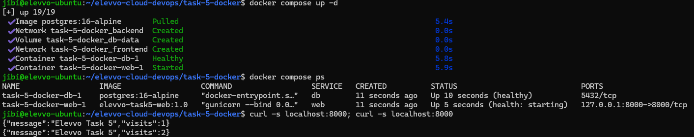
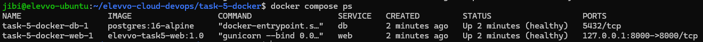
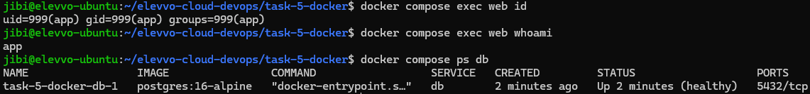
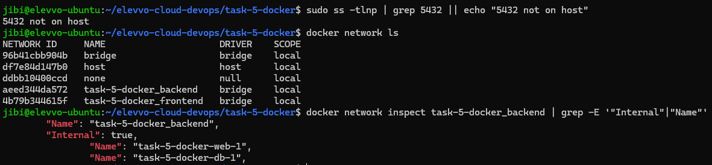

# Task 5: Multi-Stage Docker Build and Private Networking

## Goal

Containerize a small web app and run it with a database, the secure way:

1. A **multi-stage Dockerfile**: build tools stay in a "builder" stage, and only a small runtime image ships.
2. The container runs as a **non-root user**.
3. **Docker Compose** runs the app and a PostgreSQL database on a **private bridge network**, so the database port is never exposed to the host.
4. **Bonus:** scan the final image with **Trivy** and block it if it has High or Critical vulnerabilities.

> ✍️ **My explanation:**
> _Guide questions:_
> - What is a container, compared to a VM?
> - Why does image size matter?

---

## Environment

| Item | Value |
|---|---|
| VM | `elevvo-ubuntu`, Ubuntu 24.04.5 LTS (from [Task 0](../task-0-environment/README.md)) |
| Docker | Docker Engine 29.10.0, Docker Compose v5.8.0 |
| App | Flask + gunicorn, talks to PostgreSQL with psycopg 3 |
| Database | `postgres:16-alpine`, data in a named volume |
| Scanner | Trivy (run as the `aquasec/trivy` container) |

### Files in this folder

| File | What it is |
|---|---|
| [app.py](app.py) | The Flask app: `/health` and `/` (counts visits in Postgres) |
| [requirements.txt](requirements.txt) | Python packages, pinned to exact versions |
| [Dockerfile](Dockerfile) | The real, multi-stage build |
| [Dockerfile.single](Dockerfile.single) | Single-stage, runs as root. **Only for the size comparison, never run.** |
| [compose.yaml](compose.yaml) | Runs `web` and `db` on two networks |
| [.env.example](.env.example) | DB settings with a **fake** password. The real `.env` is never committed. |
| [.gitignore](.gitignore) / [.dockerignore](.dockerignore) | Keep `.env`, caches and virtualenvs out of Git and out of the image |
| [scan-and-run.sh](scan-and-run.sh) | Build, scan with Trivy, and start the stack only if the scan passes |

---

## Architecture

```text
Laptop / VM shell
      |
      |  curl 127.0.0.1:8000   (published on localhost only)
      v
+-------------------- network: frontend (bridge) ---------------------+
|   web  (elevvo-task5-web:1.0, user "app", read-only filesystem)     |
+---------------------------------|-----------------------------------+
                                  |  host "db", port 5432
+-------------------- network: backend (bridge, internal: true) ------+
|   web  <---------------------->  db  (postgres:16-alpine)           |
|                                  |                                  |
|                                  v                                  |
|                         volume: db-data                             |
+---------------------------------------------------------------------+
```

- `web` is on **both** networks: `frontend` so its port can be published, `backend` so it can reach the database.
- `db` is **only** on `backend`. That network is `internal: true`, so it has no route to the outside, and `db` has no `ports:` line, so nothing on the host can reach 5432.
- `web` finds the database by its service name `db`. Compose gives each network its own internal DNS.

> ✍️ **My explanation:**
> _Guide questions:_
> - What is a bridge network?
> - What does `internal: true` add on top of just not publishing the port?

---

## Steps

### 1. Make room on the disk

Ubuntu's installer only used about half of the 30G disk for the root volume (`/`). Docker images are big, so I gave the rest of the disk to it:

```bash
jibi@elevvo-ubuntu:~$ df -h /
Filesystem                         Size  Used Avail Use% Mounted on
/dev/mapper/ubuntu--vg-ubuntu--lv   14G  5.8G  7.2G  45% /
jibi@elevvo-ubuntu:~$ sudo lvextend -l +100%FREE -r /dev/ubuntu-vg/ubuntu-lv
  Size of logical volume ubuntu-vg/ubuntu-lv changed from <14.00 GiB (3583 extents) to <28.00 GiB (7167 extents).
  Logical volume ubuntu-vg/ubuntu-lv successfully resized.
resize2fs 1.47.0 (5-Feb-2023)
Filesystem at /dev/mapper/ubuntu--vg-ubuntu--lv is mounted on /; on-line resizing required
The filesystem on /dev/mapper/ubuntu--vg-ubuntu--lv is now 7339008 (4k) blocks long.

jibi@elevvo-ubuntu:~$ df -h /
Filesystem                         Size  Used Avail Use% Mounted on
/dev/mapper/ubuntu--vg-ubuntu--lv   28G  5.8G   21G  23% /
```

- `-l +100%FREE`: give the volume all the free space left in the volume group.
- `-r`: also grow the filesystem, so the new space is usable right away. This works while `/` is mounted.

<details><summary>Screenshot</summary>


</details>

> ✍️ **My explanation:**
> _Guide questions:_
> - What are a physical volume, a volume group and a logical volume in LVM?
> - Why could this be done without a reboot?

---

### 2. Install Docker

Installed Docker Engine with Docker's official install script. It adds Docker's apt repo and installs the engine, CLI, containerd and the Compose and Buildx plugins:

```bash
jibi@elevvo-ubuntu:~$ curl -fsSL https://get.docker.com | sudo sh
...
+ sh -c DEBIAN_FRONTEND=noninteractive apt-get -y -qq install docker-ce docker-ce-cli containerd.io docker-compose-plugin docker-ce-rootless-extras docker-buildx-plugin docker-model-plugin >/dev/null
INFO: Docker daemon enabled and started
```

<details><summary>Screenshot</summary>


</details>

Then added `jibi` to the `docker` group (`sudo usermod -aG docker jibi`, then log out and back in) so I don't need `sudo` for every Docker command:

```bash
jibi@elevvo-ubuntu:~$ groups
jibi adm cdrom sudo dip plugdev lxd docker
jibi@elevvo-ubuntu:~$ docker version && docker compose version
Client: Docker Engine - Community
 Version:           29.10.0
...
Server: Docker Engine - Community
 Engine:
  Version:          29.10.0
  API version:      1.57 (minimum version 1.40)
...
Docker Compose version v5.8.0
```

The `Server` section means my user can talk to the Docker daemon without `sudo`.

> ⚠️ **The `docker` group is root-equivalent.** Anyone in it can start a container that mounts the host's `/` and change anything. Only trusted admins should be in it. On this VM that is only me, and I already have `sudo`.

<details><summary>Screenshot</summary>


</details>

> ✍️ **My explanation:**
> _Guide questions:_
> - Why is piping a script from the internet into `sudo sh` risky, and why was it OK here?
> - Why is the `docker` group as powerful as root?

---

### 3. The app and its secrets

[app.py](app.py) is a small Flask app run by gunicorn (a production web server, instead of Flask's built-in dev server):

- `GET /health` returns `{"status": "ok"}`. The healthcheck uses it.
- `GET /` adds a row to a `visits` table in Postgres and returns the count. If the count goes up, the app and database are really talking.

The database settings come from environment variables, never from the code:

```python
DSN = (f"host={os.environ['DB_HOST']} dbname={os.environ['POSTGRES_DB']} "
       f"user={os.environ['POSTGRES_USER']} password={os.environ['POSTGRES_PASSWORD']}")
```

**Secrets:** I copied [.env.example](.env.example) to `.env` and put a real password in it, made with `openssl rand -hex 16` (32 random hex characters). Compose loads `.env` into both containers with `env_file: .env`.

- `.env` is in [.gitignore](.gitignore), so it never goes into Git.
- `.env` is in [.dockerignore](.dockerignore), so it is never sent to the Docker build and can't end up baked into the image.
- The repo only has `.env.example` with `POSTGRES_PASSWORD=change-me`.

```bash
jibi@elevvo-ubuntu:~/elevvo-cloud-devops/task-5-docker$ cp .env.example .env
jibi@elevvo-ubuntu:~/elevvo-cloud-devops/task-5-docker$ nano .env
```

<details><summary>Screenshot</summary>


</details>

> ✍️ **My explanation:**
> _Guide questions:_
> - Why must the password not be written in the Dockerfile with `ENV`?
> - What is the difference between `.gitignore` and `.dockerignore`?

---

### 4. The multi-stage Dockerfile

Full file: [Dockerfile](Dockerfile).

**Stage 1, builder** (`python:3.12`, the big image with compilers and tools): makes a virtualenv in `/venv` and installs the Python packages into it.

```dockerfile
FROM python:3.12 AS builder
RUN python -m venv /venv
ENV PATH="/venv/bin:$PATH"
COPY requirements.txt .
RUN pip install --no-cache-dir -r requirements.txt
```

**Stage 2, runtime** (`python:3.12-slim`): starts fresh and copies in **only** `/venv` and `app.py`. Everything else from the builder is thrown away.

```dockerfile
FROM python:3.12-slim AS runtime
RUN apt-get update && apt-get upgrade -y && rm -rf /var/lib/apt/lists/*
RUN groupadd --system app && useradd --system --gid app --no-create-home app
WORKDIR /app
COPY --from=builder /venv /venv
COPY --chown=app:app app.py .
ENV PATH="/venv/bin:$PATH" PYTHONDONTWRITEBYTECODE=1 PYTHONUNBUFFERED=1
USER app
EXPOSE 8000
HEALTHCHECK --interval=30s --timeout=3s \
  CMD python -c "import urllib.request; urllib.request.urlopen('http://localhost:8000/health')"
CMD ["gunicorn", "--bind", "0.0.0.0:8000", "--workers", "2", "app:app"]
```

| Line | Why |
|---|---|
| `apt-get upgrade -y` | Patches the OS packages in the shipped image. Added after Trivy found a HIGH CVE (see [Bonus](#bonus-trivy-scan-as-a-gate)). `rm -rf /var/lib/apt/lists/*` deletes the package lists so they don't add size. |
| `groupadd --system app && useradd --system ...` | Creates a system user `app` with no home folder. |
| `USER app` | Everything after this, including the app itself, runs as `app`, not root. |
| `COPY requirements.txt` before the app code | Layer caching: the slow `pip install` only re-runs when the requirements change, not on every code change. |
| `PYTHONDONTWRITEBYTECODE=1` | Python won't try to write `.pyc` files, which matters because the container's filesystem is read-only. |
| `HEALTHCHECK` | Docker calls `/health` every 30s and marks the container `healthy` or `unhealthy`. |

Built it with Compose (it uses `build: .` and tags the image `elevvo-task5-web:1.0`):

```bash
jibi@elevvo-ubuntu:~/elevvo-cloud-devops/task-5-docker$ docker compose build
[+] Building 8.8s (17/17) FINISHED
 => [builder 2/4] RUN python -m venv /venv
 => [runtime 2/5] RUN groupadd --system app && useradd --system --gid app --no-create-home app
 => [builder 3/4] COPY requirements.txt .
 => [builder 4/4] RUN pip install --no-cache-dir -r requirements.txt
 => [runtime 4/5] COPY --from=builder /venv /venv
 => [runtime 5/5] COPY --chown=app:app app.py .
 => => naming to docker.io/library/elevvo-task5-web:1.0
 ✔ Image elevvo-task5-web:1.0 Built
```

The `[builder ...]` and `[runtime ...]` steps show the two stages. Only `runtime` becomes the final image. (This first build had no `apt-get upgrade` yet.)

<details><summary>Screenshot</summary>


</details>

> ✍️ **My explanation:**
> _Guide questions:_
> - Why is the build environment not needed at runtime?
> - Why `COPY --chown=app:app`?

---

### 5. Size comparison: single-stage vs multi-stage

[Dockerfile.single](Dockerfile.single) builds the same app in **one** stage on the full `python:3.12` image, running as root. It is only here to compare sizes.

```bash
jibi@elevvo-ubuntu:~/elevvo-cloud-devops/task-5-docker$ docker build -f Dockerfile.single -t elevvo-task5-web:single .
[+] Building 19.9s (10/10) FINISHED
...
 => => naming to docker.io/library/elevvo-task5-web:single
```

<details><summary>Screenshot</summary>


</details>

```bash
jibi@elevvo-ubuntu:~/elevvo-cloud-devops/task-5-docker$ docker images | grep elevvo-task5-web
elevvo-task5-web:1.0      2d4f9af5bb9f       223MB         54.3MB
elevvo-task5-web:single   1ab6e63dea83       1.64GB          422MB
```

| Image | On disk | Compressed |
|---|---|---|
| `single` (one stage, `python:3.12`) | 1.64GB | 422MB |
| `1.0` (multi-stage, `python:3.12-slim`) | **223MB** | **54.3MB** |

The multi-stage image is about **7 times smaller**. It also has no compilers or build tools, so an attacker who gets in has much less to work with.

<details><summary>Screenshot</summary>


</details>

> ✍️ **My explanation:**
> _Guide questions:_
> - Where did the 1.4GB difference go?
> - Besides size, why is a smaller image safer?

---

### 6. Compose: two networks, one hidden database

Full file: [compose.yaml](compose.yaml). The parts that matter:

```yaml
services:
  web:
    image: elevvo-task5-web:1.0
    env_file: .env
    ports:
      - "127.0.0.1:8000:8000"
    depends_on:
      db:
        condition: service_healthy
    networks: [frontend, backend]
    read_only: true
    tmpfs: [/tmp]
    cap_drop: [ALL]
    security_opt: ["no-new-privileges:true"]

  db:
    image: postgres:16-alpine
    env_file: .env
    volumes: [db-data:/var/lib/postgresql/data]
    networks: [backend]
    healthcheck:
      test: ["CMD-SHELL", "pg_isready -U $${POSTGRES_USER} -d $${POSTGRES_DB}"]

networks:
  frontend:
    driver: bridge
  backend:
    driver: bridge
    internal: true
```

| Setting | What it does |
|---|---|
| `127.0.0.1:8000:8000` | Publishes the app on **localhost only**. Docker writes its own iptables rules for published ports, and those **skip UFW**. A plain `8000:8000` would be open to the whole LAN even with UFW set to deny. Binding to `127.0.0.1` avoids that. |
| `db` has no `ports:` | Postgres is never published to the host. |
| `backend: internal: true` | The backend network has no route out, so `db` can't reach the internet either. |
| `depends_on: condition: service_healthy` | `web` waits until `db` passes `pg_isready`, not just until the container starts. |
| `db-data` named volume | Database files live outside the container, so they survive `docker compose down` and rebuilds. |
| `read_only: true` + `tmpfs: [/tmp]` | The app can't change its own files. Only `/tmp` is writable, and it lives in memory. |
| `cap_drop: [ALL]` | Removes every Linux capability. The app only needs to listen on port 8000, which needs none. |
| `no-new-privileges:true` | Stops any process inside from gaining more privileges (for example through a setuid binary). |
| `$${POSTGRES_USER}` | `$$` makes Compose pass a literal `$` to the container, so the variable is read inside the container, not by Compose. |

Started it and tested:

```bash
jibi@elevvo-ubuntu:~/elevvo-cloud-devops/task-5-docker$ docker compose up -d
[+] up 19/19
 ✔ Image postgres:16-alpine       Pulled
 ✔ Network task-5-docker_backend  Created
 ✔ Volume task-5-docker_db-data   Created
 ✔ Network task-5-docker_frontend Created
 ✔ Container task-5-docker-db-1   Healthy
 ✔ Container task-5-docker-web-1  Started
jibi@elevvo-ubuntu:~/elevvo-cloud-devops/task-5-docker$ docker compose ps
NAME                  IMAGE                  COMMAND                  SERVICE   CREATED          STATUS                            PORTS
task-5-docker-db-1    postgres:16-alpine     "docker-entrypoint.s…"   db        11 seconds ago   Up 10 seconds (healthy)           5432/tcp
task-5-docker-web-1   elevvo-task5-web:1.0   "gunicorn --bind 0.0…"   web       11 seconds ago   Up 5 seconds (health: starting)   127.0.0.1:8000->8000/tcp
jibi@elevvo-ubuntu:~/elevvo-cloud-devops/task-5-docker$ curl -s localhost:8000; curl -s localhost:8000
{"message":"Elevvo Task 5","visits":1}
{"message":"Elevvo Task 5","visits":2}
```

- `db-1` is `Healthy` **before** `web-1` starts, which is `depends_on: service_healthy` working.
- `web` shows `127.0.0.1:8000->8000/tcp`: published on localhost only.
- `db` shows only `5432/tcp` with no `->`: the port exists inside the container but is **not** published to the host.
- `visits` goes 1, then 2: the app is writing to and reading from Postgres.

<details><summary>Screenshot</summary>


</details>

> ✍️ **My explanation:**
> _Guide questions:_
> - Why do Docker's published ports skip UFW?
> - What is the difference between `depends_on` with and without `condition: service_healthy`?
> - What happens to the visit count after `docker compose down` and `up` again? And after `down -v`?

---

## Proof

### Both containers healthy

```bash
jibi@elevvo-ubuntu:~/elevvo-cloud-devops/task-5-docker$ docker compose ps
NAME                  IMAGE                  COMMAND                  SERVICE   CREATED         STATUS                   PORTS
task-5-docker-db-1    postgres:16-alpine     "docker-entrypoint.s…"   db        2 minutes ago   Up 2 minutes (healthy)   5432/tcp
task-5-docker-web-1   elevvo-task5-web:1.0   "gunicorn --bind 0.0…"   web       2 minutes ago   Up 2 minutes (healthy)   127.0.0.1:8000->8000/tcp
```

`db` passed `pg_isready`, and `web` passed its `HEALTHCHECK` on `/health`.

<details><summary>Screenshot</summary>


</details>

### The app runs as non-root

```bash
jibi@elevvo-ubuntu:~/elevvo-cloud-devops/task-5-docker$ docker compose exec web id
uid=999(app) gid=999(app) groups=999(app)
jibi@elevvo-ubuntu:~/elevvo-cloud-devops/task-5-docker$ docker compose exec web whoami
app
jibi@elevvo-ubuntu:~/elevvo-cloud-devops/task-5-docker$ docker compose ps db
NAME                 IMAGE                COMMAND                  SERVICE   CREATED         STATUS                   PORTS
task-5-docker-db-1   postgres:16-alpine   "docker-entrypoint.s…"   db        2 minutes ago   Up 2 minutes (healthy)   5432/tcp
```

`uid=999(app)`, not `uid=0(root)`.

<details><summary>Screenshot</summary>


</details>

### The database is hidden from the host

```bash
jibi@elevvo-ubuntu:~/elevvo-cloud-devops/task-5-docker$ sudo ss -tlnp | grep 5432 || echo "5432 not on host"
5432 not on host
jibi@elevvo-ubuntu:~/elevvo-cloud-devops/task-5-docker$ docker network ls
NETWORK ID     NAME                     DRIVER    SCOPE
96b41cbb904b   bridge                   bridge    local
df7e84d147b0   host                     host      local
ddbb10400ccd   none                     null      local
aeed344da572   task-5-docker_backend    bridge    local
4b79b344615f   task-5-docker_frontend   bridge    local
jibi@elevvo-ubuntu:~/elevvo-cloud-devops/task-5-docker$ docker network inspect task-5-docker_backend | grep -E '"Internal"|"Name"'
        "Name": "task-5-docker_backend",
        "Internal": true,
                "Name": "task-5-docker-web-1",
                "Name": "task-5-docker-db-1",
```

- Nothing on the host is listening on 5432.
- `task-5-docker_backend` is `"Internal": true`, and only `web-1` and `db-1` are on it.

<details><summary>Screenshot</summary>


</details>

---

## Bonus: Trivy scan as a gate

[scan-and-run.sh](scan-and-run.sh) builds the image, scans it, and only starts the stack if the scan passes:

```bash
#!/usr/bin/env bash
set -euo pipefail
IMAGE=elevvo-task5-web:1.0
docker compose build
docker run --rm -v /var/run/docker.sock:/var/run/docker.sock \
  aquasec/trivy:latest image --severity HIGH,CRITICAL --ignore-unfixed --exit-code 1 "$IMAGE"
echo "Scan passed, starting stack"
docker compose up -d
```

- Trivy runs as a container. Mounting `/var/run/docker.sock` lets it read the image from the local Docker daemon, so I didn't have to install Trivy on the VM.
- `--severity HIGH,CRITICAL`: only count serious findings.
- `--exit-code 1`: exit with code 1 if any are found. Because of `set -e`, the script stops right there, so `docker compose up -d` never runs.
- `--ignore-unfixed`: skip CVEs that have no fix released yet, since there is nothing I can upgrade to. Fixable ones still fail the gate.

### First scan: blocked

The first run found **1 HIGH** in the official `python:3.12-slim` base image (Debian 13.7). All Python packages were clean:

```text
jibi@elevvo-ubuntu:~/elevvo-cloud-devops/task-5-docker$ chmod +x scan-and-run.sh && ./scan-and-run.sh
✔ Image elevvo-task5-web:1.0 Built
...
INFO Detected OS family="debian" version="13.7"

Report Summary
│ elevvo-task5-web:1.0 (debian 13.7)                                         │ debian     │ 1 │
│ venv/lib/python3.12/site-packages/flask-3.0.3.dist-info/METADATA           │ python-pkg │ 0 │
│ venv/lib/python3.12/site-packages/gunicorn-22.0.0.dist-info/METADATA       │ python-pkg │ 0 │
│ venv/lib/python3.12/site-packages/psycopg-3.2.1.dist-info/METADATA         │ python-pkg │ 0 │
│ venv/lib/python3.12/site-packages/werkzeug-3.1.9.dist-info/METADATA        │ python-pkg │ 0 │
...

elevvo-task5-web:1.0 (debian 13.7)
Total: 1 (HIGH: 1, CRITICAL: 0)

│ Library │ Vulnerability  │ Severity │ Status │ Installed Version           │ Fixed Version                    │ Title                                   │
│ zlib1g  │ CVE-2026-85091 │ HIGH     │ fixed  │ 1:1.3.dfsg+really1.3.1-1+b1 │ 1:1.3.dfsg+really1.3.1-1+deb13u1 │ zlib: Heap buffer overflow in gz_vacate │
│         │                │          │        │                             │                                  │ allows arbitrary code execution         │
```

- `zlib1g` (a compression library) had a heap buffer overflow that could allow code execution.
- Status `fixed` means Debian already released a patched version, so this one counts even with `--ignore-unfixed`.
- The script stopped after the report. "Scan passed, starting stack" never printed: **the gate worked.**

### Fix and rescan: passed

Added `apt-get update && apt-get upgrade -y` to the **runtime** stage (the one that ships), then rebuilt with `--pull` so Docker also checked for a newer base image:

```text
jibi@elevvo-ubuntu:~/elevvo-cloud-devops/task-5-docker$ docker compose build --pull
 => [runtime 2/6] RUN apt-get update && apt-get upgrade -y && rm -rf /var/lib/apt/lists/*   2.7s
...
 ✔ Image elevvo-task5-web:1.0 Built
jibi@elevvo-ubuntu:~/elevvo-cloud-devops/task-5-docker$ docker run --rm -v /var/run/docker.sock:/var/run/docker.sock aquasec/trivy:latest image --severity HIGH,CRITICAL --ignore-unfixed --exit-code 1 elevvo-task5-web:1.0
...
Report Summary
│ elevvo-task5-web:1.0 (debian 13.7)                                         │ debian     │ 0 │
│ venv/lib/python3.12/site-packages/flask-3.0.3.dist-info/METADATA           │ python-pkg │ 0 │
│ venv/lib/python3.12/site-packages/gunicorn-22.0.0.dist-info/METADATA       │ python-pkg │ 0 │
│ venv/lib/python3.12/site-packages/psycopg-3.2.1.dist-info/METADATA         │ python-pkg │ 0 │
│ venv/lib/python3.12/site-packages/werkzeug-3.1.9.dist-info/METADATA        │ python-pkg │ 0 │
...
jibi@elevvo-ubuntu:~/elevvo-cloud-devops/task-5-docker$ echo $?
0
```

**0 HIGH/CRITICAL** in the OS and in every Python package, and exit code `0`, so the gate would now let the stack start.

### Full gate run: passed and started

Running the whole script again now goes all the way through:

```text
jibi@elevvo-ubuntu:~/elevvo-cloud-devops/task-5-docker$ ./scan-and-run.sh
 => CACHED [runtime 2/6] RUN apt-get update && apt-get upgrade -y && rm -rf /var/lib/apt/lists/*
...
 ✔ Image elevvo-task5-web:1.0 Built
...
INFO Detected OS family="debian" version="13.7"

Report Summary
│ elevvo-task5-web:1.0 (debian 13.7)                                         │ debian     │ 0 │
│ venv/lib/python3.12/site-packages/flask-3.0.3.dist-info/METADATA           │ python-pkg │ 0 │
│ venv/lib/python3.12/site-packages/gunicorn-22.0.0.dist-info/METADATA       │ python-pkg │ 0 │
│ venv/lib/python3.12/site-packages/psycopg-3.2.1.dist-info/METADATA         │ python-pkg │ 0 │
│ venv/lib/python3.12/site-packages/werkzeug-3.1.9.dist-info/METADATA        │ python-pkg │ 0 │
...
Legend:
- '-': Not scanned
- '0': Clean (no security findings detected)

Scan passed, starting stack
[+] up 2/2
 ✔ Container task-5-docker-db-1  Healthy
 ✔ Container task-5-docker-web-1 Started
```

Same script, same command. The only change was the patched image, and this time it printed "Scan passed, starting stack" and ran `docker compose up -d`.

> ✍️ **My explanation:**
> _Guide questions:_
> - Why scan **before** running, not after?
> - Why did an "official" image ship with a HIGH CVE?
> - What is the trade-off of `--ignore-unfixed`?

---

## What I learned

- **Fixes only count in the stage that ships.** I first put `apt-get upgrade` in the builder stage. That stage is thrown away, so it did nothing for the final image. It had to go in the runtime stage.
- **Docker can only `COPY` files that exist in the build context.** I saved the requirements file as `requirements.py` instead of `.txt` (you can see the `nano requirements.py` in the [create-files screenshot](screenshots/04-create-files.png)), and the build failed with "not found".
- **Line continuations (`\`) break when pasting.** If only the first line of a multi-line command gets pasted, the shell runs half a command.
- **"Official" doesn't mean "patched".** Trivy found a real HIGH CVE in the official Python base image on day one. Scanning catches what base images still ship.
- **Ignore files as a precaution.** `.venv/` and `venv/` are in both `.gitignore` and `.dockerignore`, so a local virtualenv never ends up in Git or in the image.

> ✍️ **My explanation:**
> _Guide questions:_
> - What was the hardest part, and how did you figure it out?
> - What would you change to make this production ready?